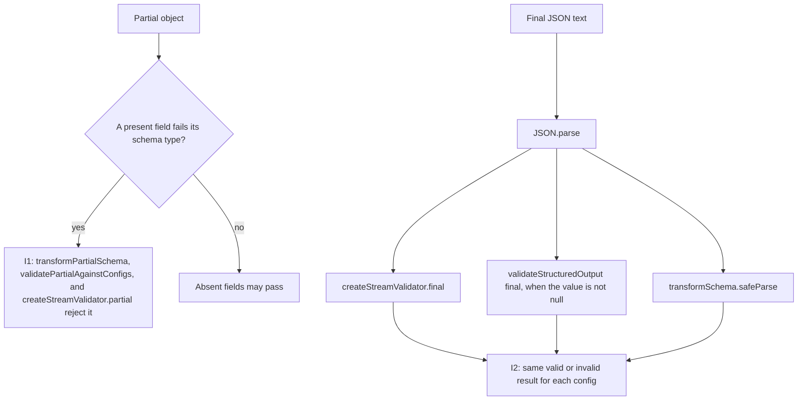

# Property-checked invariants of partial and stream validation

I1 and I2 are input-output properties of pure functions. fast-check generates Zod schemas, configs, and values and runs the real TypeScript. No separate TLA+ or Lean model is checked in. A model of the prefix scanner would not execute `partialSchemaFor`, so it could pass while a present field is accepted. The prefix machine is a single-threaded scan in `parsePartialJson`, not a set of concurrent events. CI does not install a model checker or a proof assistant. The model-based fast-check run below drives that scan on the real parser and demands I1 at every parsed prefix. That run has been seen to fail when the fallback schema accepts every value.

## When a change needs this check

Run the check when a diff touches any of these:

- `packages/core/src/partial.ts` — `partialSchemaFor`, `transformPartialSchema`, `validatePartialAgainstConfigs`
- `packages/core/src/stream.ts` — `parsePartialJson`, `createStreamValidator`, `validateStructuredOutput`
- `packages/core/src/index.ts` — `transformSchema` (the I2 reference)
- `packages/core/src/__tests__/partial-stream.invariants.property.test.ts`

A formatting-only edit does not change what the check describes. A new branch inside `partialSchemaFor` or `final` does. `makeStreamingConditionalTransformer` and `createAgUiPartialValidator` are outside this check.

## Properties

### I1 — an invalid present field is rejected

Harm: a streamed form can keep an already-wrong field and only fail after the model finishes.

Statement: for a schema and a config in the fragment below, and for any partial value, `transformPartialSchema`, `validatePartialAgainstConfigs`, and `createStreamValidator().partial` accept the partial if and only if every present field conforms to its schema type. A missing key may pass. An unknown key is not a schema field. Zod object schemas strip unknown keys, and the oracle ignores them.

Oracle: `presentFieldsConform` in the property file. It walks the partial. It does not call the functions under test. Leaves are string, finite number, boolean, or a fixed enum. A present object must be a non-null non-array object. A present array must be an array whose elements conform. Optionality does not weaken a present value.

### I2 — final validation matches full validation

Harm: a consumer trusts `final` or `validateStructuredOutput` and disagrees with `transformSchema` on the same config.

Statement: let `parsed` be `JSON.parse(text)`. For each config, `createStreamValidator(schema, configs).final(parsed)` has the same `valid` flag as `transformSchema(schema, config).safeParse(parsed).success`, and `errors` is null exactly when that parse succeeds. `validateStructuredOutput({ final: parsed }, schema, configs).final` matches the same flags when `parsed !== null`.

`final` receives the parsed value. Callers pass objects today (`stream.test.ts`). Passing the raw JSON text is a different check and is not I2.

`null` is the "no final yet" sentinel. `validateStructuredOutput({ final: null })` returns `final: null` and does not produce per-config flags. `createStreamValidator().final(null)` still has to match `safeParse(null)`. The existing unit test locks the sentinel.

## How to run

Property file: `packages/core/src/__tests__/partial-stream.invariants.property.test.ts`.

Tool: fast-check 4.10.3 (root devDependency) and Vitest.

```text
pnpm exec vitest run packages/core/src/__tests__/partial-stream.invariants.property.test.ts
```

CI runs this file inside the existing `verify` and `zod-latest` jobs via `pnpm test` (typecheck, then `vitest run --coverage`). There is no separate job. Each `it` has a 15 second timeout. A local run of the file is well under 20 seconds.

On failure, fast-check prints `{ seed, path }`. Replay by adding that `seed` and `path` to the failing `fc.assert` options, confirm the counterexample, then remove them.

## Bounds and assumptions

Checked fragment, not every Zod schema:

- Roots are objects or arrays. I2 roots are objects, because `transformSchema` requires an object unless the root is an array and the config has `*`.
- Nodes are objects, arrays, optional fields, string, finite number, boolean, and enums drawn from `red`, `green`, `blue`, `gold`.
- Shared fast-check depth identifier, `maxDepth` 2. At most 3 fields, named `alpha`, `beta`, `gamma`, `delta`. Generated arrays have length at most 2. Strings have length at most 8.
- Configs are `true`, `false`, `{}`, or a nested object. Array configs may set `*`. Two configs are checked on every case: `primary` and `secondary`.
- Runs: I1 80, prefix model 40, I2 60.
- The prefix model appends the `JSON.stringify` of the partial in 8-character chunks, calls `parsePartialJson` after each chunk, and requires I1 on every defined parse. A finished text must parse to the same value as `JSON.parse`.

Assumptions: Zod does not coerce. `z.number()` rejects `NaN` and infinities. Object unknown-key policy is strip, not strict. Config `false` may wrap a present field in `.optional()` and must still reject a present value of the wrong type.

## What a failure means

Replay the shrunk value in the words of the schema.

- `presentFieldsConform` is false and an API returns `valid: true`: the product accepted a present field that fails its schema type. That is a bug in `partial.ts` or in `createStreamValidator().partial`. Do not edit the oracle so the bug passes.
- `presentFieldsConform` is true and an API returns `valid: false`: the product rejected a partial whose present fields conform. Absent keys are allowed to be missing. That is a bug, unless a commit message, test, or changelog says partial validation became strict on purpose. Cite that evidence before changing the property.
- I2 `valid` differs from `safeParse().success` for one config: `final` or `validateStructuredOutput` no longer calls `transformSchema` for that config. That is a bug.
- The shrunk value uses a Zod feature the oracle does not model (a refinement, a default, a union): the harness is wrong. Fix the harness. Do not change product code to match it.

## Shown to fail, then restored

These edits were applied only long enough to see a red run. They are not in the tree.

- I1: the non-container fallback in `partialSchemaFor` returned `z.any()`. First failure: partial value `false`, schema `{ alpha: { alpha: string[] } }`, config `{}`. The value is present and is not an object. `transformPartialSchema` returned valid. The prefix model failed the same way when a chunk parsed as the number `0` against an object of strings.
- I2: `createStreamValidator().final` returned `valid: true` for every config. Failure: text `[]`, nested object schema, config `{ alpha: { alpha: true } }`. `transformSchema(...).safeParse` was false and `final` was true.

After both edits were reverted, the three tests passed.

## Keeping the check in step with the code

Sync commit for the covered functions: `fa857ef0a84720482854b7fc31bf0c93a3513449`.

At that commit, `partial.ts`, `stream.ts`, and `transformSchema` are the functions this harness describes. Move the sync commit forward only after you have re-read those functions, confirmed the harness still describes them, seen the check pass, and seen one real break of the guarded check fail. A pass on a stale description checks nothing.

If the promise itself changes on purpose, rewrite the property in the same change and cite the test, the changelog, or the commit message. Otherwise leave the property alone and fix the code.

For drift that landed without this skill, use `/maintain-formal-verification-skill`.

## Not checked

- Schemas deeper than the bound, or with more than three fields, or with array lengths above two, except whatever a single shrunk counterexample happens to use.
- Unions, intersections, tuples, records, lazy schemas, recursive `z.lazy`, refinements (`email`, `min`, `int`), defaults, catch, preprocess, pipes, and branded types.
- `makeStreamingConditionalTransformer` and the per-id buffer in `createAgUiPartialValidator`.
- That `parsePartialJson` never invents a field value that was not yet in the text, beyond I1 on whatever value it does return, and beyond equality with `JSON.parse` on a finished text.
- Interleavings. There is no concurrent state to model-check.
