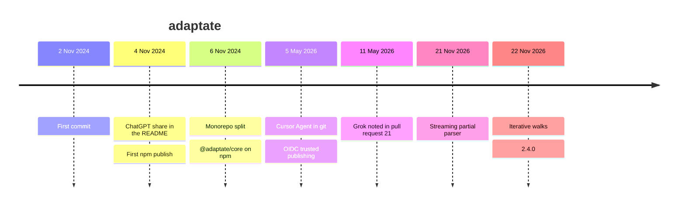

# The adaptate journey

The problem started at Oneflow, where entity schemas did not match across endpoints while I was building features. I wrote the precursor by hand, alone. I wanted to open-source it back then; it didn't happen. After I lost access to the code (nothing secret was kept), I rebuilt adaptate from general programming concepts — recursion and mutual recursion. No Oneflow code is in adaptate.

## Origin

This repository starts at the [initial commit](https://github.com/p10ns11y/adaptate/commit/f506830ac98a4e8b2a2629c97585eb31bc0acabb) on 2 Nov 2024, then [the first source](https://github.com/p10ns11y/adaptate/commit/2999c5815226b3b6810f3a0784b81057b5f4d7e1) the next day. That first source walks Zod objects recursively.

## Rebuild

A [ChatGPT Canvas share](https://chatgpt.com/share/6728eb4e-07f8-8005-b586-c4b8ee0e798c) was added to the README on 4 Nov 2024, in [the v0.0.3 commit](https://github.com/p10ns11y/adaptate/commit/c3721c0f1f2aa515e66e38525db63a563283bad5) that also fixed edge cases and grew the tests. The same share stayed in the README through [v2.0.0](https://github.com/p10ns11y/adaptate/commit/ce1947bddf977479ffc2efd81fea0546e0b5a306). That README recorded that the prototype used `.required()` where `.unwrap()` was needed, and that this was corrected by hand.

The share link was removed on 11 May 2026, in [the #21 work](https://github.com/p10ns11y/adaptate/pull/21) ([7e1c611](https://github.com/p10ns11y/adaptate/commit/7e1c611614d73a98d1f8b3032c8551a44776baea)).

## Publish

The first npm publish was [`adaptate@0.1.0`](https://www.npmjs.com/package/adaptate/v/0.1.0) on 4 Nov 2024. [`adaptate@0.0.1`](https://www.npmjs.com/package/adaptate/v/0.0.1) followed later that day. The monorepo split is [a49a375](https://github.com/p10ns11y/adaptate/commit/a49a3752ee6c4a5cd63d60e7c8506cf159f2a70c) on 6 Nov 2024; [`@adaptate/core@0.0.7`](https://www.npmjs.com/package/@adaptate/core/v/0.0.7) was published that evening.

## Cursor, Grok, and 2.4

[Cursor Agent](https://github.com/p10ns11y/adaptate/commit/395cfb1f7182d8aeea4da7edbf3f997f4e2cc267) first appears in git on 5 May 2026. The same day brought [OIDC trusted publishing](https://github.com/p10ns11y/adaptate/commit/e9a15d6c48c3ebc143a982648b73d15e6032ba69) ([#17](https://github.com/p10ns11y/adaptate/pull/17), then [#19](https://github.com/p10ns11y/adaptate/pull/19) and [#20](https://github.com/p10ns11y/adaptate/pull/20)), later hardened in [#31](https://github.com/p10ns11y/adaptate/pull/31). [#21](https://github.com/p10ns11y/adaptate/pull/21) is where the project first recorded Grok as an agent on the work.

Streaming partial validation landed in [#48](https://github.com/p10ns11y/adaptate/pull/48) on 21 Nov 2026. On 22 Nov 2026, [#66](https://github.com/p10ns11y/adaptate/pull/66) replaced unbounded recursive walks with explicit stacks, and [#69](https://github.com/p10ns11y/adaptate/pull/69) cut [v2.4.0](https://github.com/p10ns11y/adaptate/releases/tag/v2.4.0).
