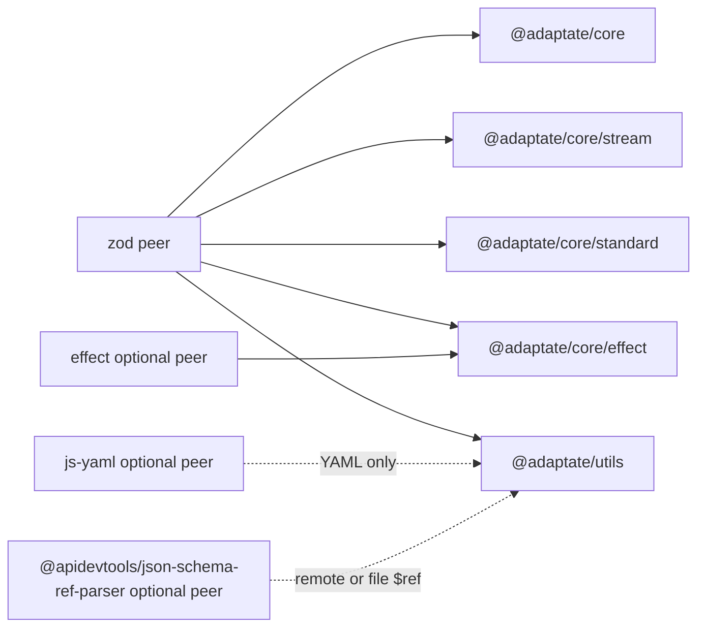

# Adaptate

Dynamic and Adaptable Model Validator Using Zod, Interoperable with OpenAPI

<!-- Packages on npm -->
[](https://www.npmjs.com/package/adaptate)
[](https://www.npmjs.com/package/@adaptate/core)
[](https://www.npmjs.com/package/@adaptate/utils)
[](https://www.npmjs.com/package/@adaptate/core)
[](https://bundlephobia.com/package/@adaptate/core)
[](https://www.npmjs.com/package/@adaptate/core)

<!-- Build, quality, supply chain -->
[](https://github.com/p10ns11y/adaptate/actions/workflows/ci.yml)
[](./coverage)
[](https://socket.dev/npm/package/adaptate/overview)
[](./LICENSE)
[](https://github.com/p10ns11y/adaptate/commits/main)
[](https://github.com/p10ns11y/adaptate/issues)
[](https://github.com/p10ns11y/adaptate/stargazers)

<!-- Language & toolchain -->
[](./tsconfig.json)
[](https://nodejs.org)
[](https://pnpm.io)
[](https://zod.dev)
[](./.devcontainer/README.md)

## Overview

`adaptate` is a dynamic and adaptable model validator that leverages Zod for schema validation and is interoperable with OpenAPI. Define a single optional Zod schema for your data model, then use configuration objects to declare which fields each consumer requires — at runtime.

## Packages

| Package | Description |
|---------|-------------|
| [`@adaptate/core`](packages/core/) | Schema transformation engine — make fields required based on config |
| [`@adaptate/utils`](packages/utils/) | OpenAPI ↔ Zod conversion, YAML spec loading with `$ref` resolution |

## Installation

```sh
pnpm add @adaptate/core
# or
npm install @adaptate/core
```

For OpenAPI utilities:

```sh
pnpm add @adaptate/utils
# or
npm install @adaptate/utils
```

Peer dependency: `zod@^3.25.0 || ^4.0.0`

## 2.4



`@adaptate/core` publishes four entries and has no `dependencies`. `zod` is the required peer. `effect` is imported only by `@adaptate/core/effect`.

| Entry | What it exports |
| --- | --- |
| `@adaptate/core` | `transformSchema`, `makeConditionalSchemaTransformer`, partial helpers |
| `@adaptate/core/stream` | `parsePartialJson`, `createStreamValidator`, AG-UI adapter |
| `@adaptate/core/standard` | Standard Schema validation (`zod`, Valibot, ArkType) |
| `@adaptate/core/effect` | `validate`, `validatePartial`, `createEffectStreamValidator` |

`@adaptate/utils` has no required runtime dependencies. In-document `$ref` pointers use the local resolver. `js-yaml` is imported only when the document is YAML, and a missing package throws `Optional peer dependency "js-yaml" is required to parse YAML`. `@apidevtools/json-schema-ref-parser` is imported only for a remote or file `$ref`, and a missing package throws `Optional peer dependency "@apidevtools/json-schema-ref-parser" is required to resolve remote or file $ref pointers`.

```ts
import { Effect } from "effect";
import { z } from "zod";
import { createEffectStreamValidator } from "@adaptate/core/effect";

const recipe = z.object({
  title: z.string().optional(),
  servings: z.number().optional(),
});
const validator = createEffectStreamValidator(recipe, {
  card: { title: true },
  kitchen: { servings: true },
});

const report = Effect.runSync(validator.final('{"title":"Pasta"}'));
// report.configs.card.valid === true
// report.configs.kitchen.valid === false

const card = Effect.runSync(validator.final('{"title":"Pasta"}', "card"));
// { title: "Pasta" }
```

`final(text)` parses with `JSON.parse`, requires the base schema, and returns `{ value, configs }` for every named config. `final(text, "card")` validates only that config and returns the parsed value. A `configName` that is not an own key of `configs` fails with `AdaptateValidationError` and a custom issue `unknown config`. Install `effect@^4.0.0` to import this entry.

### 2.3 → 2.4

- Install `js-yaml@^5.5.0` if you parse YAML, and `@apidevtools/json-schema-ref-parser@^16.0.8` if you resolve remote or file `$ref`s. In 2.3.0 those were dependencies (`js-yaml` 4, parser 15). In-document `$ref`s stay on the local resolver.
- `@adaptate/core/effect` is new. `final(text)` and `final(text, configName)` are documented above.
- [#51](https://github.com/p10ns11y/adaptate/pull/51) moved the utils packages to parser 16 and js-yaml 5. `@types/js-yaml` is unused because js-yaml 5 ships its own types. The Zod peer stays `^3.25.0 || ^4.0.0`.

CI compares a pull request with its base and fails when any case is more than 5% slower (`scripts/bench-compare.mjs`, limit `1.05`). The [#53](https://github.com/p10ns11y/adaptate/pull/53) run reported `transformSchema` 1.043, `transformPartialSchema` 1.002, `parsePartialJson` 0.989, `agUiStream` 0.996. A fuller A/B eval versus raw Zod and Valibot is coming in its own section.

`scripts/ts-consumer-check.mjs` typechecks the packed tarballs on TypeScript 7 and 6 for `bundler`, `node16`, and `nodenext`. The CI job is `ts7-consumer`.

## The Problem

In component-oriented applications, different components consume different subsets of the same data model. One component needs `name` and `age`, another needs `address.city`, and a third needs everything. The data often comes from different API endpoints with varying completeness.

Without runtime validation per consumer, you either:
- Make everything optional (no safety) 
- Make everything required (breaks partial views)
- Maintain separate schemas per component (duplication nightmare)

**Adaptate** solves this: define one schema with all fields optional, then use a config object to declare what each consumer requires.

## Usage

### Make Fields Required by Configuration

There are two common ways to create a fully optional schema:

**1. Using `.deepPartial()` (recommended)**

```ts
import { z } from 'zod';
import { transformSchema, type Config } from '@adaptate/core';

const schema = z.object({
  name: z.string(),
  age: z.number(),
  address: z.object({
    street: z.string(),
    city: z.string(),
  }),
}).deepPartial();

const config = {
  name: true,
  age: true,
  address: { city: true },
} satisfies Config<z.infer<typeof schema>>;

const updatedSchema = transformSchema(schema, config);

updatedSchema.parse({ name: 'Davin', age: 30, address: { city: 'Pettit' } }); // passes
updatedSchema.parse({ name: 'Davin', age: 30, address: { street: 'Main St' } }); // throws
```

**2. Manual `.optional()` (still works)**

```ts
import { z } from 'zod';
import { transformSchema } from '@adaptate/core';

const schema = z.object({
  name: z.string().optional(),
  age: z.number().optional(),
  address: z.object({
    street: z.string().optional(),
    city: z.string().optional(),
  }).optional(),
});

// ... same config and usage as above
```

### Conditional Requirements

<details>
<summary>Make fields required based on runtime data</summary>

```ts
import { z } from 'zod';
import { makeConditionalSchemaTransformer } from '@adaptate/core';

const schema = z.object({
  parentContactNumber: z.number().optional(),
  age: z.number().optional(),
});

const config = {
  parentContactNumber: { requiredIf: (data: any) => data.age < 18 },
  age: true,
};

const data = { age: 17 };
const transformer = makeConditionalSchemaTransformer(data)(schema, config);

transformer.run(); // throws — parentContactNumber required because age < 18
```

</details>

### OpenAPI ↔ Zod Conversion

<details>
<summary>Convert OpenAPI schemas to Zod and back (now fully feature-complete)</summary>

**Load and dereference an OpenAPI spec:**

```ts
import { getDereferencedOpenAPIDocument } from '@adaptate/utils';

const doc = await getDereferencedOpenAPIDocument({
  location: 'filesystem',
  callSiteURL: import.meta.url,
  relativePathToSpecFile: './api-spec.yml',
});
```

**Convert OpenAPI schema to Zod:**

```ts
import { openAPISchemaToZod } from '@adaptate/utils';

const zodSchema = openAPISchemaToZod({
  type: 'object',
  required: ['age'],
  properties: {
    name: { type: 'string', minLength: 2 },
    age: { type: 'integer', minimum: 0 },
  },
});
```

**Convert Zod to OpenAPI schema:**

```ts
import { z } from 'zod';
import { zodToOpenAPISchema } from '@adaptate/utils';

const openAPISchema = zodToOpenAPISchema(
  z.object({ name: z.string().min(2), age: z.number().int() })
);
```

See [`@adaptate/utils` README](packages/utils/README.md) for full documentation.

</details>

## Design Philosophy

**Compact & Powerful**: The core transformation logic is intentionally compact — fewer than 100 lines of code. Complex nested transformations (deep objects, arrays with wildcards, conditional requirements) are handled elegantly through recursion. This keeps the API surface small while delivering sophisticated behavior with minimal cognitive overhead.

**For a deeper dive**, see [`DESIGN.md`](DESIGN.md) which covers:
- Detailed code walkthroughs
- Runtime complexity analysis (O(N) time, O(D) space)
- Performance characteristics and trade-offs
- Comparison with alternative approaches

## Development

This is a pnpm monorepo orchestrated with Turborepo.

**Package manager:** Use **[pnpm](https://pnpm.io/) only** when working in this repository (`pnpm install`). This repo’s **install/build safety posture** is defined for pnpm (`.npmrc`, `pnpm-workspace.yaml`: lifecycle restrictions, store integrity, release-age gates, etc.). **`npm install`** at the root is unsupported — npm ignores or mishandles several of those controls and may resolve dependencies differently than CI, **weakening protections against supply-chain attacks** that the config is meant to mitigate. Root `package.json` pins [`packageManager`](https://nodejs.org/api/packages.html#packagemanager). The **Installation** section above (`pnpm add` / `npm install` for `@adaptate/*`) applies to **consumers** installing published packages from the npm registry.

**Requirements:** Node.js ≥ 20, pnpm 9.12.3

```sh
pnpm install          # Install dependencies
pnpm build            # Full pipeline: check-types → test → build
pnpm test             # Run Vitest in watch mode
npx vitest run        # Single test run
npx turbo run check-types  # TypeScript type checking
```

### Project Structure

```
├── .devcontainer/     # optional Dev Container (Node 24 + pnpm)
├── packages/
│   ├── core/         # @adaptate/core — schema transformation
│   └── utils/        # @adaptate/utils — OpenAPI utilities
├── skills/           # Tool-agnostic agent SOPs
├── AGENTS.md         # Agent guidelines
├── CODING_STYLE.md   # Coding conventions
└── turbo.json        # Turborepo task graph
```

See [`AGENTS.md`](AGENTS.md) and [`skills/`](skills/) for development guidelines and operational procedures. Optional **dev container**: [`.devcontainer/README.md`](.devcontainer/README.md), [`.devcontainer/devcontainer.json`](.devcontainer/devcontainer.json).

## Credits

This library recreates and generalizes a pattern originally observed at [Oneflow AB](https://oneflow.com), where the same data model was consumed by different components with varying required fields depending on context.

**Development note**: Initial prototype was created with ChatGPT Canvas. All important caveats and refinements were manually corrected by the author. The PR (#21) marks the first use of AI coding agents (Grok) in the project. Cursor Cloud Agent prepared the repo for agentic development workflows.

## License

MIT
