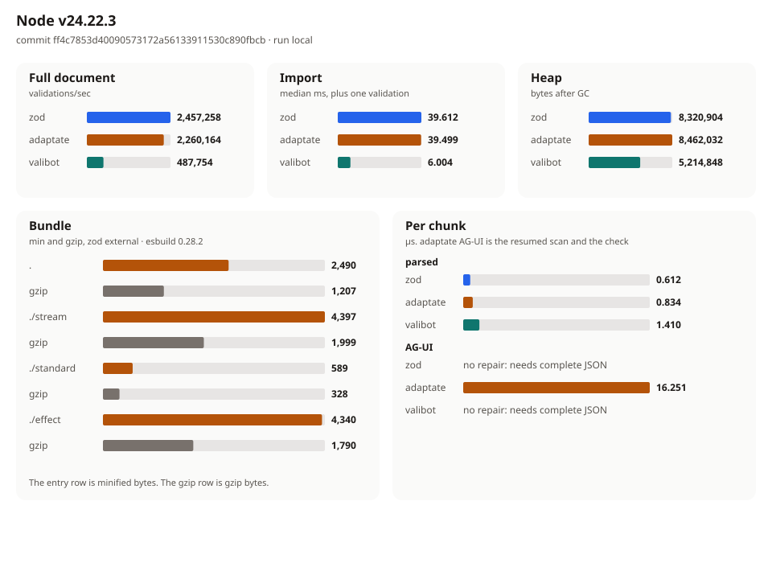

<p align="center">
  <picture>
    <source media="(prefers-color-scheme: dark)" srcset="assets/logo-dark.svg">
    
  </picture>
</p>

<p align="center">
  <strong>One description. Each screen checks only what it shows. A cut-off reply does not throw.</strong>
</p>

<p align="center">
  <a href="https://www.npmjs.com/package/@adaptate/core"></a>
  <a href="https://www.npmjs.com/package/@adaptate/core"></a>
  <a href="https://bundlephobia.com/package/@adaptate/core"></a>
  <a href="https://www.npmjs.com/package/@adaptate/core"></a>
  <a href="https://github.com/p10ns11y/adaptate/actions/workflows/ci.yml"></a>
  <a href="./LICENSE"></a>
  <a href="https://github.com/p10ns11y/adaptate/stargazers"></a>
</p>

<p align="center">
  <picture>
    <source media="(prefers-color-scheme: dark)" srcset="assets/stream-demo-dark.gif">
    
  </picture>
</p>

<p align="center">
  <a href="https://github.com/p10ns11y/adaptate/stargazers"><strong>Star</strong></a>
  &nbsp;·&nbsp;
  <a href="https://stackblitz.com/github/p10ns11y/adaptate/tree/main/examples/streaming-tool-call"><strong>Try it in the browser</strong></a>
</p>

## The same tool call, two ways

The model has sent `{"title":"Pas` so far.

<table>
<tr>
<th width="50%">Without Adaptate</th>
<th width="50%">With Adaptate</th>
</tr>
<tr>
<td valign="top">
<pre><code>const args = '{"title":"Pas';
JSON.parse(args);</code></pre>
<code>JSON.parse</code> throws. The card stays blank.
</td>
<td valign="top">
<pre><code>const check = push({
  type: "TOOL_CALL_ARGS",
  toolCallId: "call-1",
  delta: '{"title":"Pas',
});</code></pre>
<code>check.partial</code> is <code>{ title: "Pas" }</code>. The card check passes.
</td>
</tr>
</table>

`push` is the three-line quick start below. Run it in [examples/streaming-tool-call](examples/streaming-tool-call).

## What it's for

<table>
<tr>
<td width="33%" align="center">
  <picture>
    <source media="(prefers-color-scheme: dark)" srcset="assets/icon-card-dark.svg">
    
  </picture>
  <br>
  A card shows the dish name while the kitchen is not ready yet.
</td>
<td width="33%" align="center">
  <picture>
    <source media="(prefers-color-scheme: dark)" srcset="assets/icon-chat-dark.svg">
    
  </picture>
  <br>
  A chat checks a tool call while the model is still typing.
</td>
<td width="33%" align="center">
  <picture>
    <source media="(prefers-color-scheme: dark)" srcset="assets/icon-page-dark.svg">
    
  </picture>
  <br>
  An API write-up becomes those checks, and can be written back out.
</td>
</tr>
</table>

## Quick start

```sh
pnpm add @adaptate/core zod
```

```ts
import { z } from "zod";
import { createAgUiPartialValidator } from "@adaptate/core/stream";
const push = createAgUiPartialValidator(z.object({ title: z.string(), servings: z.number() }), { card: { title: true } });
```

## Design

One walk of the schema. [DESIGN.md](DESIGN.md) records O(N) time and O(D) space. A partial JSON stream scans each new character once. [Incremental partial JSON](docs/incremental-parser.md)

## Measured

<p align="center">
  <picture>
    <source media="(prefers-color-scheme: dark)" srcset="assets/perf-dark.svg">
    
  </picture>
</p>

Node v24.22.3. One `node bench/ab/run.js`. Parsed partial 0.840 µs/chunk against raw Zod 0.605 µs/chunk. AG-UI 17.137 µs/chunk. [Performance](docs/performance.md)

## Why trust it

The lines above are about the check being right. [Proof](docs/proof.md) · [CI](https://github.com/p10ns11y/adaptate/actions/workflows/ci.yml)

[Views](docs/transform.md) · [Streaming](docs/streaming.md) · [OpenAPI](docs/openapi.md) · [Effect](docs/effect.md) · [Peers and subpaths](docs/subpaths.md)

MIT
