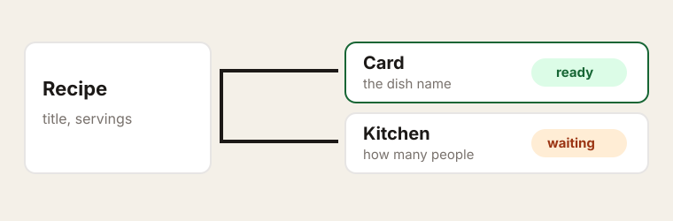

# Adaptate

[](https://www.npmjs.com/package/@adaptate/core)
[](https://www.npmjs.com/package/@adaptate/core)
[](https://bundlephobia.com/package/@adaptate/core)
[](https://www.npmjs.com/package/@adaptate/core)
[](https://github.com/p10ns11y/adaptate/actions/workflows/ci.yml)
[](./LICENSE)
[](https://github.com/p10ns11y/adaptate/stargazers)

**See which screen can use an AI reply before the model finishes typing.**

- You describe the data once. Every screen shares that description.
- Each screen asks only for the fields it actually shows.
- While the reply is still arriving, a screen turns ready as soon as it has enough.




## Try it

```sh
pnpm add @adaptate/core
```

```ts
import { z } from "zod";
import { transformSchema } from "@adaptate/core";

const recipe = z.object({
  title: z.string().optional(),
  servings: z.number().optional(),
});
const card = transformSchema(recipe, { title: true });
card.parse({ title: "Pasta" });
```

## Where it helps

- A card can show the dish name while the kitchen still waits for how many people it serves.
- A chat can check a tool call while the model is still typing.
- An API write-up can become those checks, and the checks can be written back out.
- The same checks run in ordinary code or in an Effect pipeline.

[Proof](docs/proof.md)

[Views](docs/transform.md) · [Streaming](docs/streaming.md) · [OpenAPI](docs/openapi.md) · [Effect](docs/effect.md) · [Peers and subpaths](docs/subpaths.md)

MIT
