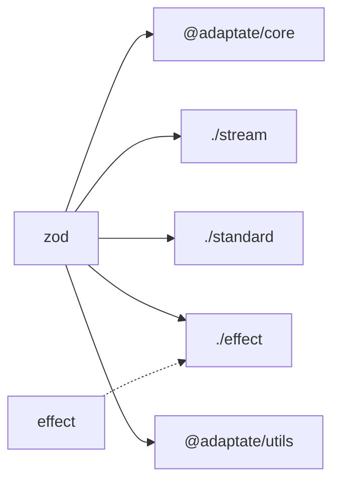

# Adaptate

One Zod schema, many consumer views. A config marks which fields each view requires. Streamed partial JSON can be checked as it arrives.

## Use cases

- One schema for a card view and a detail view, with different required fields.
- Check streamed tool-call arguments in a chat UI before the JSON is complete.
- Turn an OpenAPI document into Zod, and Zod back into OpenAPI.
- Validate a Standard Schema from Zod, Valibot, or ArkType.
- Run the same checks inside an Effect pipeline.

## Install

```sh
pnpm add @adaptate/core
```

Peer: `zod@^3.25.0 || ^4.0.0`. OpenAPI helpers: `pnpm add @adaptate/utils`.

```ts
import { z } from "zod";
import { transformSchema } from "@adaptate/core";

const recipe = z.object({
  title: z.string().optional(),
  servings: z.number().optional(),
});
const card = transformSchema(recipe, { title: true });
card.parse({ title: "Pasta" });
card.parse({ servings: 2 }); // throws
```

## Packages



## Docs

| Doc | What it holds |
| --- | --- |
| [Subpaths](docs/subpaths.md) | Entries and what each one exports |
| [Transform](docs/transform.md) | `transformSchema` and conditional configs |
| [Streaming](docs/streaming.md) | Partial JSON and AG-UI |
| [Effect](docs/effect.md) | `final(text)` and `final(text, configName)` |
| [OpenAPI](docs/openapi.md) | Spec load and Zod conversion |
| [Optional peers](docs/optional-peers.md) | `effect`, `js-yaml`, ref parser |
| [Migration 2.4](docs/migration-2.4.md) | What a 2.3 install changes |
| [Performance](docs/performance.md) | CI bench |
| [TypeScript](docs/typescript.md) | Consumer typecheck |
| [Development](docs/development.md) | pnpm, scripts, layout |

MIT
