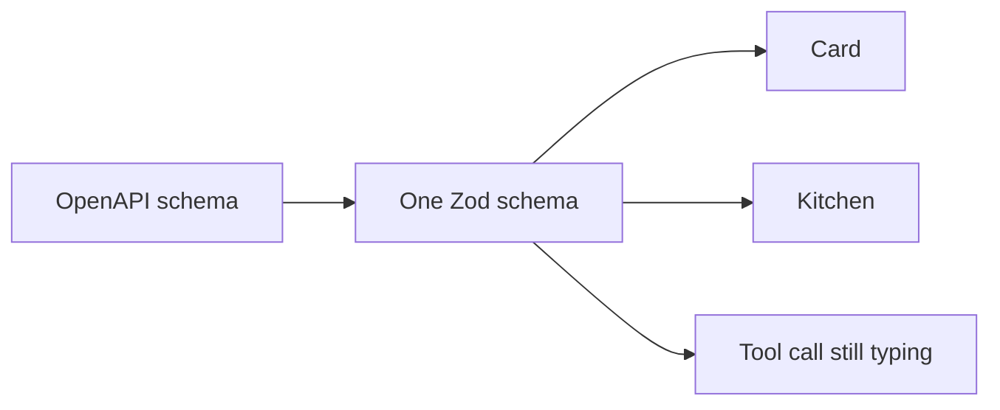

<p align="center">
  <picture>
    <source media="(prefers-color-scheme: dark)" srcset="docs/assets/brand/lockup-dark.svg">
    
  </picture>
</p>

<p align="center">
  <strong>Partial documents fail a full schema, and deep input overflows a recursive walk.</strong>
</p>

## What you can count on

| | |
| --- | --- |
| **100,000 levels** | Streamed JSON, including a missing last character. OpenAPI to Zod, Zod to OpenAPI, and a local `$ref` document. |
| **Under 3 seconds** | One `$ref` at each of those 100,000 levels. |
| **`RangeError` past 500** | A nested `$ref` chain stops at depth 500. |

[Core deep-nesting test](packages/core/src/__tests__/deep-nesting.test.ts) · [Utils deep-nesting test](packages/utils/src/__tests__/deep-nesting.test.ts) · [Local `$ref` test](packages/utils/src/__tests__/dereference-local.test.ts) · [Proof](docs/proof.md)



## Before and after

The model has sent `{"title":"Pas`.

| `JSON.parse` | `@adaptate/core/stream` |
| --- | --- |
| Throws `SyntaxError`. | `check.partial` is `{ title: "Pas" }`. `check.results.card.valid` is `true`. |

```ts
import { z } from "zod";
import { createAgUiPartialValidator } from "@adaptate/core/stream";

const recipe = z.object({ title: z.string(), servings: z.number() });
const push = createAgUiPartialValidator(recipe, { card: { title: true } });
const check = push({
  type: "TOOL_CALL_ARGS",
  toolCallId: "call-1",
  delta: '{"title":"Pas',
});
```

The same partial reader returns the leaf of a 100,000-level document with the last character missing. [Streaming tool call](examples/streaming-tool-call)

## 30-second quickstart

```sh
pnpm add @adaptate/core zod
```

```ts
import { z } from "zod";
import { transformSchema } from "@adaptate/core";
const recipe = z.object({ title: z.string(), servings: z.number() });
const card = transformSchema(recipe.partial(), { title: true });
card.parse({ title: "Pasta" });
```

`{ title: "Pas" }` passes that card. The same schema with `servings: true` rejects it. [React view](examples/react-view)

## Where it fits

| You have | You call | Read |
| --- | --- | --- |
| A screen or a form that needs some fields | `transformSchema` | [Transform](docs/transform.md) |
| A tool call that is still typing | `createAgUiPartialValidator` | [Streaming](docs/streaming.md) |
| An OpenAPI schema | `openAPISchemaToZod` | [OpenAPI](docs/openapi.md) |
| An Effect pipeline | `createEffectStreamValidator` | [Effect](docs/effect.md) |

Types ship in the package. CI checks the packed tarballs on TypeScript 7 and 6, for `bundler`, `node16`, and `nodenext`. [TypeScript](docs/typescript.md) · [API](docs/api/index.md) · [Docs](docs/index.md)

## Credits

Donald E. Knuth, "Structured Programming with go to Statements", ACM Computing Surveys 6(4), 1974. The deep walks above keep their frames in an ordinary stack. The quotation is in [Performance](docs/performance.md).

MIT
