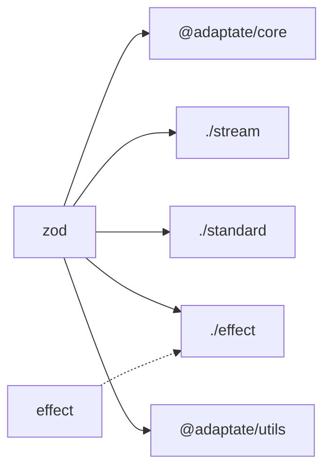

# Adaptate

One Zod schema. A config marks which fields each consumer requires ([`transformSchema`](packages/core/src/__tests__/index.test.ts)). The same document can satisfy `card` and fail `kitchen` ([title-only final](packages/core/src/__tests__/effect.test.ts)). Every parsed prefix of a stream is checked before the JSON is complete ([I1](packages/core/src/__tests__/partial-stream.invariants.property.test.ts)).

`@adaptate/core` has no `dependencies`. `zod` is the peer. `./` and `./stream` load when `effect` is not installed ([`package.json`](packages/core/package.json), [load test](packages/core/src/__tests__/effect.test.ts)).

## Use cases

- Card requires `title`, kitchen requires `servings`, one schema ([`effect.test.ts`](packages/core/src/__tests__/effect.test.ts)).
- AG-UI `TOOL_CALL_ARGS` are validated on each delta, including a cut-off string ([`stream.test.ts`](packages/core/src/__tests__/stream.test.ts)). `final` agrees with `transformSchema` per config ([I2](packages/core/src/__tests__/partial-stream.invariants.property.test.ts)).
- An OpenAPI YAML file loads from disk, and a JSON schema round-trips through Zod ([`openapi.test.ts`](packages/utils/src/__tests__/openapi.test.ts)).
- A Standard Schema (`~standard.validate`) is checked beside a transformed Zod schema ([`standard.test.ts`](packages/core/src/__tests__/standard.test.ts)).
- Effect `final(text)` reports every named config; `final(text, "card")` checks that config only ([`effect.test.ts`](packages/core/src/__tests__/effect.test.ts)).

Published `.d.ts` files are in the npm pack ([`verify-published-types.mjs`](scripts/verify-published-types.mjs), [verify job](.github/workflows/ci.yml)). Packed types are checked on TypeScript 7 and 6 for `bundler`, `node16`, and `nodenext` ([`ts7-consumer`](.github/workflows/ci.yml)). A pull request fails if any bench case is more than 5% slower ([`bench`](.github/workflows/ci.yml)). The [#53](https://github.com/p10ns11y/adaptate/pull/53) run was 0.989–1.043 ([log](https://github.com/p10ns11y/adaptate/actions/runs/44945033877)). On Node 24, Adaptate's import median was 38.052 ms against raw Zod's 36.397 ms, full-document rate 3,124,813/s against 3,239,403/s, and AG-UI 220.591 µs/chunk against 0.456 µs/chunk ([table](docs/performance.md), [ab-eval](https://github.com/p10ns11y/adaptate/actions/runs/44952333952)).

## Install

```sh
pnpm add @adaptate/core
```

Peer: `zod@^3.25.0 || ^4.0.0` ([`package.json`](packages/core/package.json)). OpenAPI helpers: `pnpm add @adaptate/utils` ([`package.json`](packages/utils/package.json)).

```ts
import { z } from "zod";
import { transformSchema } from "@adaptate/core";

const recipe = z.object({
  title: z.string().optional(),
  servings: z.number().optional(),
});
const card = transformSchema(recipe, { title: true });
card.parse({ title: "Pasta" });
card.parse({ servings: 2 }); // throws
```

## Packages



## Docs

| Doc | What it holds |
| --- | --- |
| [Subpaths](docs/subpaths.md) | Entries and what each one exports |
| [Transform](docs/transform.md) | `transformSchema` and conditional configs |
| [Streaming](docs/streaming.md) | Partial JSON and AG-UI |
| [Effect](docs/effect.md) | `final(text)` and `final(text, configName)` |
| [OpenAPI](docs/openapi.md) | Spec load and Zod conversion |
| [Optional peers](docs/optional-peers.md) | `effect`, `js-yaml`, ref parser |
| [Migration 2.4](docs/migration-2.4.md) | What a 2.3 install changes |
| [Performance](docs/performance.md) | CI bench |
| [TypeScript](docs/typescript.md) | Consumer typecheck |
| [Development](docs/development.md) | pnpm, scripts, layout |

MIT
