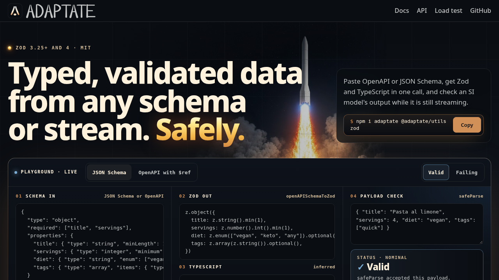
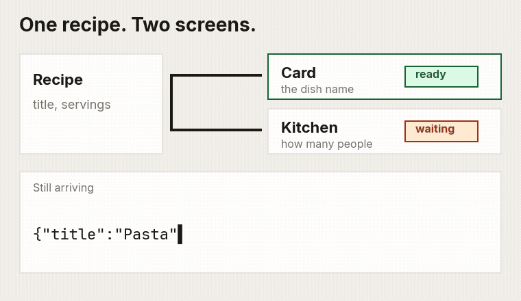
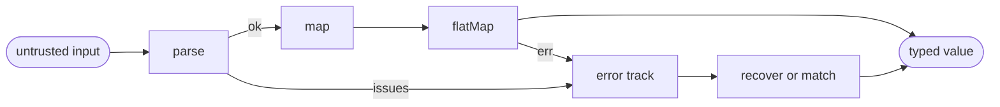

<p align="center">
  <picture>
    <source media="(prefers-color-scheme: dark)" srcset="assets/logo-dark.svg">
    
  </picture>
</p>

<p align="center">
  <a href="https://www.npmjs.com/package/adaptate"></a>
  <a href="https://www.npmjs.com/package/@adaptate/core"></a>
  <a href="https://www.npmjs.com/package/@adaptate/utils"></a>
  <a href="https://github.com/p10ns11y/adaptate/actions/workflows/ci.yml"></a>
  <a href="./coverage"></a>
  <a href="./LICENSE"></a>
  <a href="https://www.npmjs.com/package/@adaptate/core"></a>
  <a href="./tsconfig.json"></a>
  <a href="https://nodejs.org"></a>
  <a href="https://zod.dev"></a>
</p>

<h3 align="center">Typed, validated data from any schema or stream, safely.</h3>

<p align="center">Zod, OpenAPI, or any Standard Schema. A finished document, or JSON that is still arriving.</p>

```sh
pnpm add @adaptate/core zod
```

<p align="center"><a href="https://adaptate-site.vercel.app"></a></p>

## Before and after

A model is streaming a tool call. So far it has sent `{"title":"Pas`.

**Before**

```ts
JSON.parse('{"title":"Pas');
```

`SyntaxError`. There is nothing to show until the last byte arrives.

**After**

```ts
import { z } from "zod";
import { createAgUiPartialValidator } from "@adaptate/core/stream";

const recipe = z.object({ title: z.string(), servings: z.number() });
const push = createAgUiPartialValidator(recipe, { card: { title: true } });

const check = push({ type: "TOOL_CALL_ARGS", toolCallId: "call-1", delta: '{"title":"Pas' });
console.log(check?.partial, check?.results.card.valid);
```

Prints `{ title: 'Pas' } true`. `check.partial` is typed from `recipe`, so the card can show the title now.

<p align="center">
  <picture>
    <source media="(prefers-color-scheme: dark)" srcset="assets/stream-demo-dark.gif">
    
  </picture>
</p>

## One schema, one view per screen

The smallest win needs no stream. Write the schema once, then say which fields each screen needs.

```ts
import { z } from "zod";
import { transformSchema } from "@adaptate/core";

const recipe = z.object({ title: z.string(), servings: z.number() }).partial();
const card = transformSchema(recipe, { title: true });
const kitchen = transformSchema(recipe, { title: true, servings: true });

console.log(card.safeParse({ title: "Pasta" }).success, kitchen.safeParse({ title: "Pasta" }).success);
```

Prints `true false`. Each result is still a Zod schema with the same inferred type.

<details>
<summary>Nested fields, arrays, typed configs, and conditional fields</summary>

`true` makes a field required, `false` keeps it optional, a nested object goes one level down, and `{ "*": config }` applies to every array item. `satisfies Config<T>` makes a misspelled key a type error.

```ts
import { z } from "zod";
import { transformSchema, makeConditionalSchemaTransformer, type Config } from "@adaptate/core";

const order = z
  .object({
    items: z.array(z.object({ name: z.string(), qty: z.number() }).partial()),
    delivery: z.object({ address: z.string(), notes: z.string() }).partial(),
  })
  .partial();

const checkout = {
  items: { "*": { name: true, qty: true } },
  delivery: { address: true },
} satisfies Config<z.infer<typeof order>>;

const draft = { items: [{ name: "Milk" }], delivery: { address: "Main St 1" } };
console.log(transformSchema(order, checkout).safeParse(draft).success);

const pickup = z.object({ pickup: z.boolean(), address: z.string().optional() });
const rule = { address: { requiredIf: (data: { pickup: boolean }) => !data.pickup } };
console.log(makeConditionalSchemaTransformer({ pickup: false })(pickup, rule).schema.safeParse({ pickup: false }).success);
```

Prints `false` twice: the item has no `qty`, and a delivery needs an address. [Transform guide](docs/transform.md) · [React view example](examples/react-view)

</details>

## From an OpenAPI spec

Already have an API description? `@adaptate/utils` turns its schemas into Zod, and writes Zod back out.

```sh
pnpm add @adaptate/utils
```

```ts
import { openAPISchemaToZod, zodToOpenAPISchema } from "@adaptate/utils";

const recipe = openAPISchemaToZod({
  type: "object",
  required: ["title"],
  properties: { title: { type: "string", minLength: 1 }, servings: { type: "integer", minimum: 1 } },
});

console.log(recipe.safeParse({ title: "Pasta" }).success, recipe.safeParse({ servings: 2 }).success);
console.log(zodToOpenAPISchema(recipe).required);
```

Prints `true false`, then `[ 'title' ]`.

<details>
<summary>Load a spec file, resolve <code>$ref</code>s, and handle deep or circular documents</summary>

```ts
import { writeFile } from "node:fs/promises";
import { getDereferencedOpenAPIDocument, openAPISchemaToZod } from "@adaptate/utils/openapi";

await writeFile(
  new URL("./api-spec.json", import.meta.url),
  JSON.stringify({
    components: {
      schemas: {
        Recipe: { type: "object", required: ["title"], properties: { title: { $ref: "#/components/schemas/Title" } } },
        Title: { type: "string", minLength: 1 },
      },
    },
  }),
);

const doc = await getDereferencedOpenAPIDocument({
  location: "filesystem",
  callSiteURL: import.meta.url,
  relativePathToSpecFile: "./api-spec.json",
});
console.log(openAPISchemaToZod(doc.components.schemas.Recipe).safeParse({ title: "" }).success);
```

Prints `false`: the `$ref` was resolved, so `minLength: 1` applies.

- In-document `$ref`s use a built-in resolver. YAML needs the optional peer `js-yaml`, and remote or file `$ref`s need `@apidevtools/json-schema-ref-parser`. [Optional peers](docs/optional-peers.md)
- The resolver and both converters walk with loops, not recursion. Tests run each of them on a document 100,000 levels deep. [Utils deep-nesting test](packages/utils/src/__tests__/deep-nesting.test.ts)
- A `$ref` chain nested past 500 throws `RangeError`. A circular schema passed to either converter throws `RangeError` instead of running out of memory. [Local `$ref` test](packages/utils/src/__tests__/dereference-local.test.ts) · [Converter test](packages/utils/src/__tests__/openapi.test.ts)
- Supported keywords and formats: [OpenAPI guide](docs/openapi.md)

</details>

## A tool call that is still typing

Back to the stream. Each `TOOL_CALL_ARGS` delta returns what has arrived so far, typed and checked. When the call ends, `final` says which screens are ready.

```ts
import { z } from "zod";
import { createAgUiPartialValidator, createStreamValidator } from "@adaptate/core/stream";

const recipe = z.object({ title: z.string(), servings: z.number() }).partial();
const views = { card: { title: true }, kitchen: { title: true, servings: true } };
const push = createAgUiPartialValidator(recipe, views);

for (const delta of ['{"title":"Pa', 'sta","serv', 'ings":2}']) {
  console.log(push({ type: "TOOL_CALL_ARGS", toolCallId: "call-1", delta })?.partial);
}

const ready = createStreamValidator(recipe, views).final({ title: "Pasta" });
console.log(ready.card.valid, ready.kitchen.valid);
```

Prints `{ title: 'Pa' }`, `{ title: 'Pasta' }`, `{ title: 'Pasta', servings: 2 }`, then `true false`.

<details>
<summary>Partial results, other event shapes, and render throttling</summary>

- While the call is open, `results` reports whether the value so far still fits the schema. Readiness per screen comes from `final`.
- Deltas are kept per `toolCallId`. `TOOL_CALL_END` drops that call. `TEXT_MESSAGE_CONTENT` is read by `messageId`.
- `validateStructuredOutput({ partial, final }, schema, views)` takes TanStack AI style output.
- `createFrameThrottle(emit)` keeps the latest value and emits it once per animation frame, or on `setTimeout(0)` without `requestAnimationFrame`.
- `parsePartialJson` is the plain function underneath. A test reads a 100,000-level document with the last character missing. [Core deep-nesting test](packages/core/src/__tests__/deep-nesting.test.ts)

[Streaming guide](docs/streaming.md) · [Streaming tool call example](examples/streaming-tool-call)

</details>

## Read each character once

`@adaptate/core/stream` re-reads the whole buffer on every delta. `@adaptate/core/stream-incremental` keeps its place, so each new chunk is scanned once. It takes strings or bytes from any async iterable: a Node `Readable`, a Web `ReadableStream`, or a mapped SDK event stream.

```ts
import { Readable } from "node:stream";
import { fromAsyncIterable } from "@adaptate/core/stream-incremental";

const bytes = Readable.from([new TextEncoder().encode('{"title":"Pas'), new TextEncoder().encode('ta","servings":2}')]);

for await (const partial of fromAsyncIterable(bytes)) console.log(partial);
```

Prints `{ title: 'Pas' }`, then `{ title: 'Pasta', servings: 2 }`.

<details>
<summary>Same validator API, push-style feed, and the measured difference</summary>

`createAgUiPartialValidator` from `@adaptate/core/stream-incremental` has the same signature as the one in `/stream`. `createPartialJsonFeed()` returns a `feed(chunk)` function for push-style sources.

On the 966-character grocery order from the bench, the incremental feed makes 966 character visits. Re-parsing the growing buffer made 68,304. Property tests assert that visits equal the text length. [Measured run](docs/performance.md#measured) · [Incremental parser](docs/incremental-parser.md)

</details>

## Find your choke points

The places where outside data enters (a request body, a queue message, an SI model's tool call) are where bad data spreads from. `@adaptate/core/result` returns a `Result` there instead of throwing: work stays on the success track, and issues ride the error track until you `recover` or `match`.



```ts
import { z } from "zod";
import { parse, parseStream } from "@adaptate/core/result";

const invoice = z.object({ id: z.string().min(1), total: z.number().min(0) });

const total = parse(invoice, { id: "", total: -1 }).map((value) => value.total);
console.log(total.match(String, (issues) => `${issues.length} issues`));
console.log(total.recover(() => 0).value);

async function* chunks() {
  yield '{"id":"A-1","to';
  yield 'tal":12.5}';
}
for await (const step of parseStream(chunks(), invoice)) {
  if (step.done) console.log(step.result.match((value) => value.id, () => "rejected"));
}
```

Prints `2 issues`, `0`, then `A-1`. `parseStream` reads chunks through the incremental parser, and its last step errs unless the stream held one complete JSON value. A partial step checks the fields that are present; a field off `openPath` is final unless the document repeats a key on that path later (`JSON.parse` lets the last duplicate win). It reads strict JSON only, with no revivers or references: such revival is how CVE-2025-55182 (React Server Components, CVSS 10.0, December 2025) became remote code execution.

[Find your choke points](https://adaptate-site.vercel.app/docs/choke-points/) · [Guide source](docs/choke-points.md)

## Bring any Standard Schema

`@adaptate/core/standard` validates through the shared `~standard.validate` interface and adds no dependency. A transformed Zod schema is a Standard Schema too.

```ts
import { z } from "zod";
import { transformSchema } from "@adaptate/core";
import { validateAgainstStandardSchemas } from "@adaptate/core/standard";

const recipe = z.object({ title: z.string(), servings: z.number() }).partial();
const report = await validateAgainstStandardSchemas({ title: "Pasta" }, {
  card: transformSchema(recipe, { title: true }),
  kitchen: transformSchema(recipe, { title: true, servings: true }),
});

console.log(report.card.valid, report.kitchen.valid);
```

Prints `true false`. [Standard Schema test](packages/core/src/__tests__/standard.test.ts)

## Inside an Effect pipeline

`@adaptate/core/effect` runs the same checks as typed effects. `effect@^4.0.0` is an optional peer, loaded only by this entry.

```ts
import { Effect } from "effect";
import { z } from "zod";
import { createEffectStreamValidator } from "@adaptate/core/effect";

const recipe = z.object({ title: z.string().optional(), servings: z.number().optional() });
const validator = createEffectStreamValidator(recipe, { card: { title: true }, kitchen: { servings: true } });

const report = Effect.runSync(validator.final('{"title":"Pasta"}'));
console.log(report.configs.card.valid, report.configs.kitchen.valid);
```

Prints `true false`.

<details>
<summary>Errors as values</summary>

Bad or truncated JSON fails with `AdaptateParseError`. A value that fails the base schema fails with `AdaptateValidationError`. An unmet screen config does not fail the effect. `final(text, "card")` validates one config and fails if it is not met. [Effect guide](docs/effect.md)

</details>

## A custom feed, and in-memory checks

v3 adds `makeFeed` to `fromAsyncIterableSteps` and `parseStream`, so a stream can use a custom tracked feed without rewriting the parser. `@adaptate/core/verify` adds fail-closed in-memory hash and manifest checks (issue 84). Both stay in zero-dependency `@adaptate/core`. [v3 feeds](docs/v3.md) · [Runtime verification](docs/verification.md)

## Advanced: optional acceleration

Most work should stay on `@adaptate/core`. Add `@adaptate/accel`, `@adaptate/wasm`, or `@adaptate/native` only for large buffers, multi-MB verification, or a Rust/WASM host embed. Small streaming chunks (~3 µs) are already faster in pure JS, with no extra install. [Acceleration](docs/accel.md)

## Types, TypeScript 7, and Zod 3 or 4

- Types ship in both packages, inferred from the Zod schema you pass in. [TypeScript](docs/typescript.md)
- CI packs the tarballs npm would get and typechecks a consumer on TypeScript 7 and 6, each with `bundler`, `node16`, and `nodenext`. [ts-consumer-check.mjs](scripts/ts-consumer-check.mjs)
- The Zod peer range is `^3.25.0 || ^4.0.0`. CI runs the suite on the locked Zod 4 and again on `zod@latest`. [CI workflow](.github/workflows/ci.yml)
- `@adaptate/core` needs Node `>=24` and has no `dependencies`. `@adaptate/utils` needs Node `>=20`. [Subpaths](docs/subpaths.md)

## Measured, not guessed

Every pull request runs two performance gates against its base commit and fails when a gated case is more than 5% slower or larger.

| Gate | What it times |
| --- | --- |
| `bench` | `transformSchema`, `transformPartialSchema`, `parsePartialJson`, the AG-UI stream, and a 200-level transform |
| `ab-eval` | Import, full-document validation, AG-UI and parsed-partial µs per chunk, and min and gzip bytes for every entry |

<details>
<summary>Recorded numbers</summary>

- Caching the lenient partial schema took the parsed-partial check from 178.740 to 0.731 µs per chunk on the `ab-eval` runner.
- One local `bench/ab/run.js` at commit `1a51df5` (Node 24.22.3): a parsed-partial check costs 0.835 µs per chunk against 0.606 µs for raw Zod. With Zod external, `@adaptate/core` adds 1,207 bytes gzip.

Full tables, including where adaptate is slower than raw Zod: [Performance](docs/performance.md)

</details>

## Where to go next

| You want | Read |
| --- | --- |
| Every guide | [Docs](docs/index.md) |
| Where to put a Result | [Find your choke points](docs/choke-points.md) |
| A custom stream feed or in-memory check | [v3 feeds](docs/v3.md) · [Runtime verification](docs/verification.md) |
| Large-buffer acceleration | [Acceleration](docs/accel.md) |
| Each claim on this page and its test | [Proof](docs/proof.md) |
| The generated API reference | [API](docs/api/index.md) |
| Runnable apps | [React view](examples/react-view) · [Streaming tool call](examples/streaming-tool-call) · [Live load](examples/live-load) |

## Credits

Ideas this library borrows, and where to read more.

- **Donald E. Knuth, 1974.** Section 2 of [Structured Programming with go to Statements](https://doi.org/10.1145/356635.356640) turns recursion into a loop with an explicit stack. That is why a document 100,000 levels deep does not overflow. The same paper's "critical 3%" is why the gates above measure before anything is tuned.
- **[Standard Schema](https://standardschema.dev).** One `~standard` interface shared by Zod, Valibot, and ArkType, so `@adaptate/core/standard` can check any of them without depending on one.
- **[AG-UI](https://docs.ag-ui.com).** An open event protocol for agent UIs. Its `TOOL_CALL_ARGS` deltas, keyed by `toolCallId`, are the shape the stream validator reads.
- **[Zod](https://zod.dev).** `z.infer` turns a schema into a type, which lets `Config<T>` reject a misspelled field before anything runs.
- **[Effect](https://effect.website).** Failures are typed values, not thrown exceptions. `AdaptateParseError` and `AdaptateValidationError` follow that model.
- **[Railway Oriented Programming](https://fsharpforfunandprofit.com/rop/), Scott Wlaschin.** A success track and an error track joined by `map` and `bind`. `@adaptate/core/result` follows it with `map`, `flatMap` and `recover`.
- **[json-schema-ref-parser](https://github.com/APIDevTools/json-schema-ref-parser).** The reference behaviour for `$ref` resolution. It handles remote and file `$ref`s here, and the built-in resolver keeps its depth error message.
- **[overreacted.io](https://overreacted.io), Dan Abramov.** "Progressive JSON" inspired `openPath`, `tailOpen`, and the branded `Result` on stream steps. More in [Inspiration](docs/inspiration.md).

MIT
