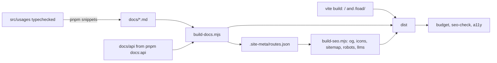

# adaptate site

The landing page, the docs, and a placeholder for the load test. Not published.



Build the packages first. `SITE_URL` defaults to `https://preview.invalid`, and every page carries `noindex` until a public domain is approved.

```sh
pnpm --filter @adaptate/utils build
pnpm --filter @adaptate/core build
pnpm --filter adaptate-site exec playwright install chromium
pnpm --filter adaptate-site build
pnpm --filter adaptate-site test
pnpm --filter adaptate-site budget
pnpm --filter adaptate-site seo-check
pnpm --filter adaptate-site a11y
```

`pnpm --filter adaptate-site snippets` writes each usage file into the docs between its `snippet` markers. `node scripts/logo.mjs <IBMPlexSans-SemiBold.otf>` rebuilds the logo files from `palette.json`. Provenance for the palette and the font is in [docs/credits.md](../../docs/credits.md).
