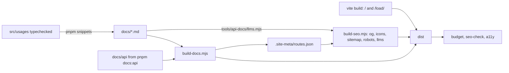

# adaptate site

The landing page, the docs, and a placeholder for the load test. Not published.



Build the packages first. `SITE_URL` defaults to `https://preview.invalid`. Pages carry `noindex` and robots.txt disallows crawling unless `SITE_INDEXABLE=1`.

Vercel serves a prebuilt `dist` (`vercel deploy --prebuilt`). Chromium runs only in CI and on the build machine, never on the Vercel builder.

```sh
pnpm --filter @adaptate/utils build
pnpm --filter @adaptate/core build
pnpm --filter adaptate-site exec playwright install chromium
pnpm --filter adaptate-site build
pnpm --filter adaptate-site test
pnpm --filter adaptate-site budget
pnpm --filter adaptate-site seo-check
pnpm --filter adaptate-site link-check
pnpm --filter adaptate-site a11y
pnpm --filter adaptate-site words
```

The landing demo runs `openAPISchemaToZod` from the `@adaptate/utils` browser build and `safeParse` in the page. It makes no network calls. The Zod text, the type preview, schema picking, and local `#/` refs are done by the page.

`pnpm --filter adaptate-site snippets` writes each usage file into the docs between its `snippet` markers. `node scripts/logo.mjs` rebuilds the mark and the favicon from `palette.json`. The lockups in `public/logo.svg` and `assets/` are static path outlines. Provenance for the palette and the logo is in [docs/credits.md](../../docs/credits.md).
