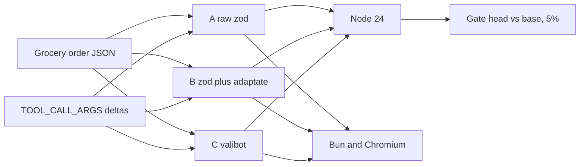

# A/B runtime eval



One grocery order, three validators. `agree.js` checks they accept and reject the same fixtures, including every stream chunk, before a number is kept.

```sh
pnpm --filter @adaptate/core build && node bench/ab/run.js
```

Gate, from the repo root, after both checkouts are built: `node bench/ab/compare.js <base checkout> . 1.05`

## Same work

| Row | What is timed |
| --- | --- |
| Full document | One `safeParse` of a schema built once. B is one `transformSchema` of the all-optional base plus `receiptConfig`. |
| Import | Module eval plus one full-document validation. Node and Bun: fresh process, one discarded warmup, then 31 samples. Chromium: fresh page, no discarded warmup. The browser bundle includes this harness on every variant, so the B−A import delta cancels it. Node and Bun import the package entry. |
| Bundle | esbuild, minify, tree-shaking. Full bundle, and a second bundle with `zod` external. `effect` is always external. |

## Not the same work

- AG-UI: B appends the delta, repairs JSON, builds a schema, then `safeParse`s. A and C `safeParse` a partial that was already parsed. For A and C that number is the parsed-partial number.
- Parsed partial: the same value. B builds a Zod schema on every call. A and C reuse one static all-optional schema.
- `./standard` and `./effect` are bundle rows only. The timed app does not call the effect wrapper.
- Valibot uses its own schemas for the same accept/reject rules.
- `createStreamValidator.final()` is not the full-document row. It rebuilds a schema per document.

## Gate

Node only, this runner, head build against the base commit: adaptate import median, full-document validations/sec, AG-UI µs/chunk, parsed-partial µs/chunk, and min plus gzip bytes for `.`, `./stream`, `./standard`, and `./effect` (full and zod-external). Fail above 5%. Timings are interleaved and re-measured up to three times. Bundle bytes are not re-measured.

Recorded, not gated: import p95, heap after `node --expose-gc`, the raw-zod control rows, Bun, and Chromium.
