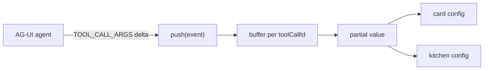

# AG-UI

An AG-UI agent streams a tool call as `TOOL_CALL_ARGS` events. Each event carries a `delta` of JSON text. `push` keeps one buffer per `toolCallId` and checks the partial value against every named config.



```ts
import { z } from "zod";
import { createAgUiPartialValidator } from "@adaptate/core/stream-incremental";

const push = createAgUiPartialValidator(
  z.object({ title: z.string(), servings: z.number() }),
  { card: { title: true } },
);
const check = push({ type: "TOOL_CALL_ARGS", toolCallId: "call-1", delta: '{"title":"Pas' });
```

`check.partial` is `{ title: "Pas" }` and `check.results.card.valid` is `true`. `JSON.parse` on the same text throws.

The file below is typechecked and run by the site tests. It builds the re-parse and incremental validators for one order schema.

<!-- snippet: usages/ag-ui.ts -->
```ts
import { createAgUiPartialValidator as createReparseAgUi } from "@adaptate/core/stream";
import { createAgUiPartialValidator as createIncrementalAgUi } from "@adaptate/core/stream-incremental";

import { cardConfig, orderSchema } from "../order-schema";

export function createReparseOrderValidator() {
  return createReparseAgUi(orderSchema, { card: cardConfig });
}

export function createIncrementalOrderValidator() {
  return createIncrementalAgUi(orderSchema, { card: cardConfig });
}
```
<!-- /snippet -->

The order schema and the card config:

<!-- snippet: order-schema.ts -->
```ts
import type { Config } from "@adaptate/core";
import { z } from "zod";

export let orderSchema = z.object({
  title: z.string(),
  notes: z.string(),
  items: z.array(
    z.object({
      sku: z.string(),
      qty: z.number(),
    }),
  ),
});

export let partialOrderSchema = orderSchema.partial();

export let cardConfig = {
  title: true,
} satisfies Config<z.infer<typeof partialOrderSchema>>;
```
<!-- /snippet -->

See [Streaming](streaming.md) for `partial` and `final`.
