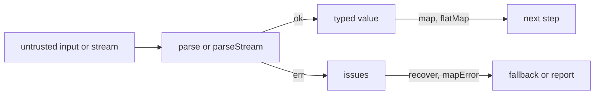

# Find your choke points

Most of an app trusts data that one small boundary already checked. Find those boundaries and give each one two tracks.



| Choke point | Schema source | Call |
| --- | --- | --- |
| API response | OpenAPI via `openAPISchemaToZod` | `parse` |
| SI tool call | Zod | `parseStream` |
| Form or import | Zod or JSON Schema | `parse` |
| Async refinement | any Standard Schema | `parseAsync` |

```ts
import { parse } from "@adaptate/core/result";

parse(schema, input).map(render).recover(showIssues);
```

The file below is typechecked and run by the site tests.

<!-- snippet: usages/choke-points.ts -->
```ts
import { parse, parseStream, type Issues } from "@adaptate/core/result";
import { openAPISchemaToZod } from "@adaptate/utils";
import { z } from "zod";

export let invoiceSchema = openAPISchemaToZod({
  type: "object",
  required: ["id", "total"],
  properties: {
    id: { type: "string", minLength: 1 },
    total: { type: "number", minimum: 0 },
  },
});

function fields(issues: Issues): string {
  return issues
    .map((issue) => {
      let first = issue.path?.[0];
      return String(typeof first === "object" ? first.key : (first ?? "input"));
    })
    .join(", ");
}

export function checkInvoice(input: unknown): string {
  return parse(invoiceSchema, input).match(
    () => "accepted",
    (issues) => `check ${fields(issues)}`,
  );
}

let toolArguments = z.object({ city: z.string(), days: z.number().int().positive() });

type Trip = { city: string; days: number; nights: number };
export type ToolCallOutcome = { previews: string[]; call?: Trip; issues?: string[] };

export async function readToolCall(chunks: AsyncIterable<string>): Promise<ToolCallOutcome> {
  let previews: string[] = [];
  let outcome: ToolCallOutcome = { previews };
  for await (let step of parseStream(chunks, toolArguments, toolArguments.partial())) {
    if (!step.done) {
      if (step.result.ok && step.result.value.city) previews.push(step.result.value.city);
      continue;
    }
    outcome = step.result
      .map((call) => ({ ...call, nights: call.days - 1 }))
      .match<ToolCallOutcome>(
        (call) => ({ previews, call }),
        (issues) => ({ previews, issues: issues.map((issue) => issue.message) }),
      );
  }
  return outcome;
}
```
<!-- /snippet -->
