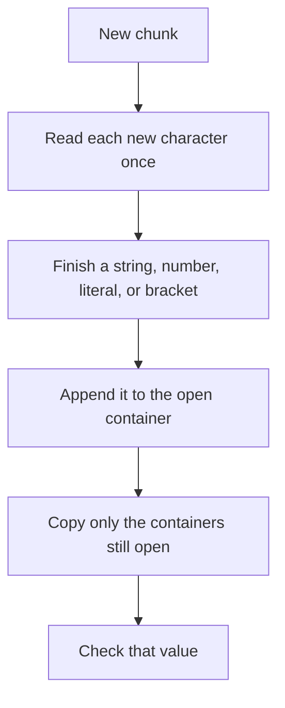

# Incremental partial JSON

Each chunk is tokenized once. A finished string, number, literal, or member is appended to the open container, and `push` copies only the containers still open. Closed values stay the same object. `visits` is the number of characters read, which is the length of the stream. On the grocery order that is 966. A full rescan of the buffer was 68,304 character visits. `parsePartialJson` still walks a whole prefix, and `@adaptate/core/stream` keeps that path. `createPartialJsonParser` and `createAgUiPartialValidator` on `@adaptate/core/stream-incremental` use the tokenizer. A value is checked with the lenient partial. An empty chunk keeps the previous value and its check. `createFrameThrottle` stays on `@adaptate/core/stream`. It keeps the latest value and emits it on the next frame, or on `setTimeout(0)` when there is no `requestAnimationFrame`.
