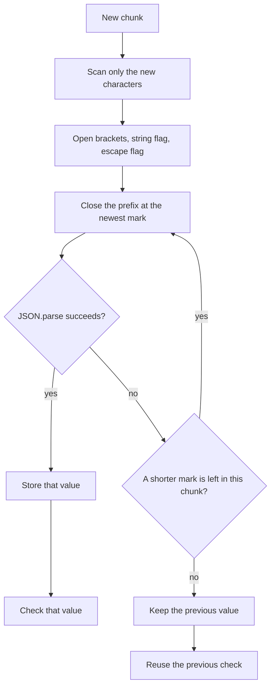

# Incremental partial JSON

Each character of the stream is scanned once. On the grocery order (966 characters, 41 chunks) that is 966 visits, against 68,304 when every chunk rescans the whole buffer. `parsePartialJson` still walks a whole prefix. `createPartialJsonParser` resumes from the previous chunk. `createAgUiPartialValidator` uses that resume. A parsed value is checked with the lenient partial. A chunk that does not parse keeps the previous value and its check. `createFrameThrottle` keeps the latest value and emits it on the next frame, or on `setTimeout(0)` when there is no `requestAnimationFrame`.
