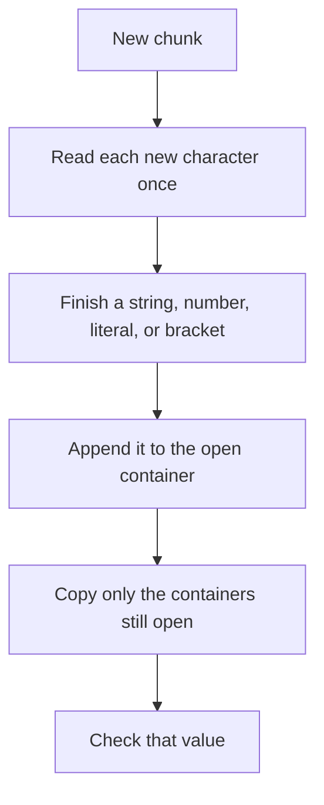

# Incremental partial JSON



`fromAsyncIterable` reads an async sequence of strings or UTF-8 bytes. Byte chunks go through `TextDecoder` with `stream: true`, and the decoder flushes after the source ends. `push` still receives a string.

```ts
import { Readable } from "node:stream";
import { pipeline } from "node:stream/promises";
import { fromAsyncIterable } from "@adaptate/core/stream-incremental";

await pipeline(readable, async function collect(source) {
  for await (const partialValue of fromAsyncIterable(source)) {
    use(partialValue);
  }
});

async function* openAiArguments(events) {
  for await (const event of events) {
    const delta = event.choices?.[0]?.delta?.tool_calls?.[0]?.function?.arguments;
    if (typeof delta === "string" && delta.length > 0) yield delta;
  }
}

async function* anthropicInputJson(events) {
  for await (const event of events) {
    const delta = event.delta;
    if (delta?.type === "input_json_delta" && typeof delta.partial_json === "string") {
      yield delta.partial_json;
    }
  }
}

for await (const partialValue of fromAsyncIterable(openAiArguments(events))) use(partialValue);
for await (const partialValue of fromAsyncIterable(anthropicInputJson(events))) use(partialValue);
```

`Readable` from Node, a Web `ReadableStream`, and either delta mapping are the same input: strings or bytes. No SDK is required.

Each chunk is tokenized once. A finished string, number, literal, or member is appended to the open container. An open string keeps the decoded prefix and any pending escape, so a push reads only the new characters. `push` copies the deepest open container and reuses the cached copies along the spine. Closed values stay the same object. On the grocery order the caller reads 966 characters. A full rescan of the buffer was 68,304 character visits. `parsePartialJson` still walks a whole prefix, and `@adaptate/core/stream` keeps that path. `createPartialJsonFeed` and `createAgUiPartialValidator` on `@adaptate/core/stream-incremental` use the tokenizer. A value is checked with the lenient partial. A whitespace chunk keeps the previous value and its check. `createFrameThrottle` stays on `@adaptate/core/stream`. It keeps the latest value and emits it on the next frame, or on `setTimeout(0)` when there is no `requestAnimationFrame`.
