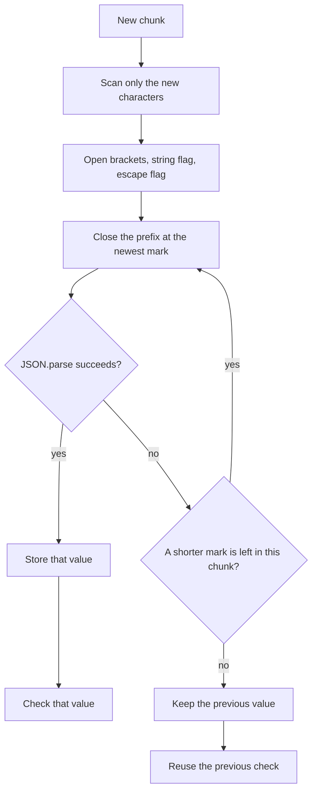

# Incremental partial JSON

The bracket scan resumes from the previous chunk, so each new character is scanned once. `JSON.parse` still receives a repaired prefix, and a chunk that does not parse at the end tries earlier ends. On the grocery order (966 characters, 41 chunks) that is 68,714 characters passed to `JSON.parse` across 130 parses. A full rescan of the buffer was 68,304 character visits. `parsePartialJson` still walks a whole prefix. `createPartialJsonParser` counts those parsed characters in `visits`. `createAgUiPartialValidator` uses the resumed scan. A parsed value is checked with the lenient partial. A chunk that does not parse keeps the previous value and its check. `createFrameThrottle` keeps the latest value and emits it on the next frame, or on `setTimeout(0)` when there is no `requestAnimationFrame`.
