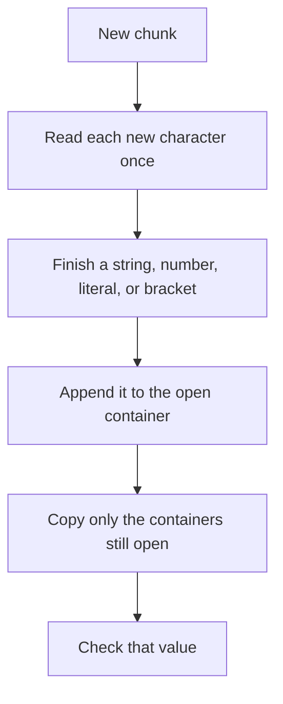

# Incremental partial JSON



`fromAsyncIterable` reads an async sequence of strings or UTF-8 bytes. Byte chunks go through `TextDecoder` with `stream: true`, and the decoder flushes after the source ends. `push` still receives a string.

```ts
import { Readable } from "node:stream";
import { fromAsyncIterable } from "@adaptate/core/stream-incremental";

const partials: unknown[] = [];
const readable = Readable.from([
  new TextEncoder().encode('{"title":"Pas'),
  new TextEncoder().encode('ta"}'),
]);

for await (const partialValue of fromAsyncIterable(readable)) {
  partials.push(partialValue);
}

type OpenAiEvent = {
  choices?: Array<{
    delta?: {
      tool_calls?: Array<{ function?: { arguments?: string } }>;
    };
  }>;
};

async function* openAiArguments(events: Iterable<OpenAiEvent> | AsyncIterable<OpenAiEvent>) {
  for await (const event of events) {
    const delta = event.choices?.[0]?.delta?.tool_calls?.[0]?.function?.arguments;
    if (typeof delta === "string" && delta.length > 0) yield delta;
  }
}

type AnthropicEvent = {
  delta?: { type?: string; partial_json?: string };
};

async function* anthropicInputJson(
  events: Iterable<AnthropicEvent> | AsyncIterable<AnthropicEvent>,
) {
  for await (const event of events) {
    const delta = event.delta;
    if (delta?.type === "input_json_delta" && typeof delta.partial_json === "string") {
      yield delta.partial_json;
    }
  }
}

const openAiEvents: OpenAiEvent[] = [
  {
    choices: [{ delta: { tool_calls: [{ function: { arguments: '{"title":"Pas' } }] } }],
  },
];
const anthropicEvents: AnthropicEvent[] = [
  { delta: { type: "input_json_delta", partial_json: '{"title":"Pas' } },
];

for await (const partialValue of fromAsyncIterable(openAiArguments(openAiEvents))) {
  partials.push(partialValue);
}
for await (const partialValue of fromAsyncIterable(anthropicInputJson(anthropicEvents))) {
  partials.push(partialValue);
}
```

`Readable` from Node, a Web `ReadableStream`, and either delta mapping are the same input: strings or bytes. No SDK is required.

Each chunk is tokenized once. A finished string, number, literal, or member is appended to the open container. An open string keeps the decoded prefix and any pending escape, so a push reads only the new characters. `push` copies the deepest open container and reuses the cached copies along the spine. Closed values stay the same object. On the grocery order in `bench/ab/order.js`, the incremental feed reads each character once. Partial JSON tests assert `visits` equals the text length. `parsePartialJson` still walks a whole prefix, and `@adaptate/core/stream` keeps that path. `createPartialJsonFeed` and `createAgUiPartialValidator` on `@adaptate/core/stream-incremental` use the tokenizer. A value is checked with the lenient partial. A whitespace chunk keeps the previous value and its check. `createFrameThrottle` stays on `@adaptate/core/stream`. It keeps the latest value and emits it on the next frame, or on `setTimeout(0)` when there is no `requestAnimationFrame`.
