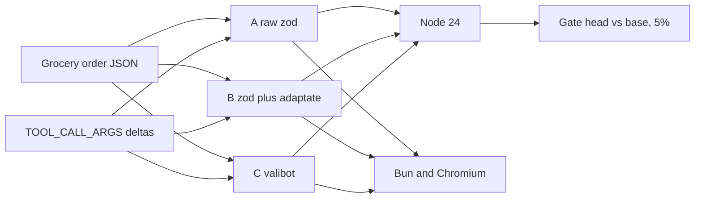

# Performance

CI compares a pull request with its base (`scripts/bench-compare.mjs`) and fails when any case is more than 5% slower (limit `1.05`). Cases: `transformSchema`, `transformPartialSchema`, `parsePartialJson`, `agUiStream`.

The [#53](https://github.com/p10ns11y/adaptate/pull/53) run reported:

| Case | Ratio (head / base) |
| --- | --- |
| `transformSchema` | 1.043 |
| `transformPartialSchema` | 1.002 |
| `parsePartialJson` | 0.989 |
| `agUiStream` | 0.996 |

[DESIGN.md](../DESIGN.md) estimates the traversal at O(N) time and O(D) space. That note is not a measured benchmark.

## A/B versus raw Zod



One grocery order, three validators. [`agree.js`](../bench/ab/agree.js) checks they accept and reject the same fixtures, including every stream chunk, before a number is kept.

```sh
pnpm --filter @adaptate/core build && node bench/ab/run.js
```

| Row | What is timed |
| --- | --- |
| Full document | One `safeParse` of a schema built once. B is one `transformSchema` of the all-optional base plus `receiptConfig`. |
| Import | Module eval plus one full-document validation. Node and Bun: a fresh process per sample, one discarded warmup, then 31 samples. Chromium: a fresh page, no discarded warmup. The browser bundle includes this harness on every variant, so the B minus A import delta cancels it. Node and Bun import the package entry. |
| Bundle | esbuild, minify, tree-shaking. Full bundle, and a second bundle with `zod` external. `effect` is always external. |

Where the work is not the same:

- AG-UI: B appends the delta, repairs JSON, builds a schema, then `safeParse`s. A and C `safeParse` a partial that was already parsed. For A and C that number is the parsed-partial number.
- Parsed partial: the same value. B builds a Zod schema on every call. A and C reuse one static all-optional schema.
- `./standard` and `./effect` are bundle rows only. The timed app does not call the effect wrapper.
- Valibot uses its own schemas for the same accept/reject rules.
- `createStreamValidator.final()` is not the full-document row. It rebuilds a schema per document.

The `ab-eval` job gates Node only, head build against the base commit, and fails above 5%: adaptate import median, full-document validations/sec, AG-UI µs/chunk, parsed-partial µs/chunk, and min plus gzip bytes for `.`, `./stream`, `./standard`, and `./effect` (full bundle and zod-external). Timings are interleaved and re-measured up to three times. Bundle bytes are not re-measured. Import p95, heap after `node --expose-gc`, the raw-zod control rows, Bun, and Chromium are uploaded with the job summary and are not gated. A positive time in B vs A is slower. A negative validations/sec is slower.

Node 24.22.3, Bun 1.4.5, and Chromium 159.0.8154.6 on `da08a4964b1ed3e10e0ae3773f4a33cdaab331b9`, job [ab-eval](https://github.com/p10ns11y/adaptate/actions/runs/44952333952), artifact `ab-eval-results`.

Workload: grocery order, 966 bytes, 41 `TOOL_CALL_ARGS` deltas of 24 characters. Import time includes module evaluation and one full-document validation. Node and Bun use a fresh process per sample, median and p95 of 31 samples after one discarded warmup. Chromium uses a fresh page per sample and no discarded warmup. Full-document and per-chunk rates are the median of 11 passes of 200 ms, one variant per process (Node, Bun) or page (Chromium). Node and Bun clocks are `process.hrtime.bigint`. The browser clock is `performance.now`.

| Metric | Runtime | A raw zod | B zod + adaptate | B vs A | C valibot |
| --- | --- | --- | --- | --- | --- |
| Import median (ms) | Node v24.22.3 | 36.397 | 38.052 | +1.655 ms (+4.547%) | 5.549 |
| Import p95 (ms) | Node v24.22.3 | 40.039 | 41.690 | +1.651 ms (+4.125%) | 5.842 |
| Full document (validations/sec) | Node v24.22.3 | 3,239,403 | 3,124,813 | -114,590 /s (-3.537%) | 630,376 |
| AG-UI stream (µs/chunk) | Node v24.22.3 | 0.456 | 220.591 | +220.135 µs (+48314.346%) | 1.008 |
| Parsed partial check (µs/chunk) | Node v24.22.3 | 0.456 | 214.042 | +213.587 µs (+46877.098%) | 1.008 |
| Heap after GC (bytes) | Node v24.22.3 | 8,302,912 | 8,572,584 | 269,672 B (+3.248%) | 5,205,240 |
| Heap delta after GC (bytes) | Node v24.22.3 | 367,128 | 523,352 | 156,224 B (+42.553%) | 52,024 |
| Import median (ms) | Bun 1.4.5 | 23.186 | 25.062 | +1.876 ms (+8.093%) | 10.072 |
| Import p95 (ms) | Bun 1.4.5 | 24.997 | 27.141 | +2.144 ms (+8.577%) | 10.558 |
| Full document (validations/sec) | Bun 1.4.5 | 1,428,063 | 1,386,563 | -41,500 /s (-2.906%) | 1,703,877 |
| AG-UI stream (µs/chunk) | Bun 1.4.5 | 0.619 | 231.584 | +230.965 µs (+37298.434%) | 1.189 |
| Parsed partial check (µs/chunk) | Bun 1.4.5 | 0.619 | 195.922 | +195.303 µs (+31539.373%) | 1.189 |
| Heap after GC (bytes) | Bun 1.4.5 | 2,086,733 | 2,361,609 | 274,876 B (+13.173%) | 665,598 |
| Heap delta after GC (bytes) | Bun 1.4.5 | 603,557 | 795,593 | 192,036 B (+31.817%) | 117,082 |
| Import median (ms) | Chromium 159.0.8154.6 | 24.800 | 25.400 | +0.600 ms (+2.419%) | 6.300 |
| Import p95 (ms) | Chromium 159.0.8154.6 | 27.100 | 28.400 | +1.300 ms (+4.797%) | 13.200 |
| Full document (validations/sec) | Chromium 159.0.8154.6 | 2,757,905 | 2,630,280 | -127,625 /s (-4.628%) | 640,440 |
| AG-UI stream (µs/chunk) | Chromium 159.0.8154.6 | 0.602 | 147.131 | +146.529 µs (+24349.126%) | 0.967 |
| Parsed partial check (µs/chunk) | Chromium 159.0.8154.6 | 0.602 | 136.992 | +136.390 µs (+22664.350%) | 0.967 |
| zod-only min / gzip (bytes) | esbuild 0.28.2 | 455,377 / 93,666 | — | — | baseline |
| `.` min / gzip | esbuild 0.28.2 | 455,377 / 93,666 | 456,345 / 93,976 | 968 / 310 B (+0.331% gzip) | — |
| `.` own min / gzip, zod external | esbuild 0.28.2 | — | 2,490 / 1,207 | +2,490 / +1,207 B | — |
| `./stream` min / gzip | esbuild 0.28.2 | 455,377 / 93,666 | 458,189 / 94,590 | 2,812 / 924 B (+0.986% gzip) | — |
| `./stream` own min / gzip, zod external | esbuild 0.28.2 | — | 4,303 / 1,900 | +4,303 / +1,900 B | — |
| `./standard` min / gzip | esbuild 0.28.2 | — | 589 / 328 | 589 / 328 B | — |
| `./standard` own min / gzip, zod external | esbuild 0.28.2 | — | 589 / 328 | +589 / +328 B | — |
| `./effect` min / gzip, effect external | esbuild 0.28.2 | 455,377 / 93,666 | 458,189 / 94,307 | 2,812 / 641 B (+0.684% gzip) | — |
| `./effect` own min / gzip, zod external, effect external | esbuild 0.28.2 | — | 4,280 / 1,681 | +4,280 / +1,681 B | — |

Gate on that run: PASS (limit 1.05).
