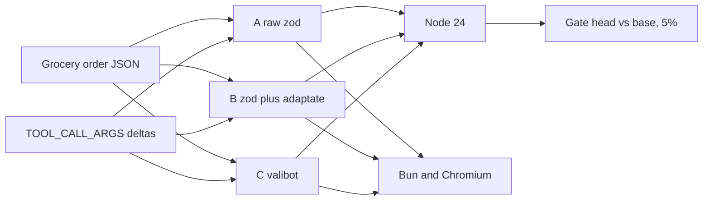

# Performance

CI compares a pull request with its base (`scripts/bench-compare.mjs`) and fails when any case is more than 5% slower (limit `1.05`). Cases: `transformSchema`, `transformPartialSchema`, `parsePartialJson`, `agUiStream`.

The [#53](https://github.com/p10ns11y/adaptate/pull/53) run reported:

| Case | Ratio (head / base) |
| --- | --- |
| `transformSchema` | 1.043 |
| `transformPartialSchema` | 1.002 |
| `parsePartialJson` | 0.989 |
| `agUiStream` | 0.996 |

[DESIGN.md](../DESIGN.md) estimates the traversal at O(N) time and O(D) space. That note is not a measured benchmark.

## A/B versus raw Zod



One grocery order, three validators. [`agree.js`](../bench/ab/agree.js) checks they accept and reject the same fixtures, including every stream chunk, before a number is kept.

```sh
pnpm --filter @adaptate/core build && node bench/ab/run.js
```

| Row | What is timed |
| --- | --- |
| Full document | One `safeParse` of a schema built once. B is one `transformSchema` of the all-optional base plus `receiptConfig`. |
| Import | Module eval plus one full-document validation. Node and Bun: a fresh process per sample, one discarded warmup, then 31 samples. Chromium: a fresh page, no discarded warmup. The browser bundle includes this harness on every variant, so the B minus A import delta cancels it. Node and Bun import the package entry. |
| Bundle | esbuild, minify, tree-shaking. Full bundle, and a second bundle with `zod` external. `effect` is always external. |

Where the work is not the same:

- AG-UI: B appends the delta, repairs JSON with `parsePartialJson` on the whole buffer, then `safeParse`s a lenient schema cached on the base schema. A and C `safeParse` a partial that was already parsed. For A and C that number is the parsed-partial number. JSON repair is the AG-UI row minus the parsed-partial row. That difference is two medians, not a separate clock, and it is not gated.
- Parsed partial: the same value. B reuses one lenient schema per base schema (`WeakMap`) and `safeParse`s it. A and C reuse one static all-optional schema. The `ab-eval` gate names this row `adaptate cached partial us/chunk` and fails when head is more than 5% slower than base.
- `./standard` and `./effect` are bundle rows only. The timed app does not call the effect wrapper.
- Valibot uses its own schemas for the same accept/reject rules.
- `createStreamValidator.final()` is not the full-document row. The validator builds one `transformSchema` result per config when it is created and reuses it. A direct `transformSchema` call still builds a schema each time, which is what the full-document row does once, outside the timed loop.

The `ab-eval` job gates Node only, head build against the base commit, and fails above 5%: adaptate import median, full-document validations/sec, AG-UI µs/chunk, cached parsed-partial µs/chunk, and min plus gzip bytes for `.`, `./stream`, `./standard`, and `./effect` (full bundle and zod-external). Timings are interleaved and re-measured up to three times. Bundle bytes are not re-measured. Import p95, heap after `node --expose-gc`, the raw-zod control rows, Bun, and Chromium are uploaded with the job summary and are not gated. A positive time in B vs A is slower. A negative validations/sec is slower.

On the same runner, the gate compared `233b1ef17f994088cc5687c0c5ea61ff7a7751a9` with the base commit (no schema cache). Parsed-partial went from 178.740 µs/chunk to 0.731 µs/chunk (ratio 0.004). AG-UI went from 206.137 µs/chunk to 20.571 µs/chunk (ratio 0.100). Full-document rate went from 3120065.726/s to 3263762.591/s (ratio 1.046). Import median went from 36.832 ms to 36.476 ms (ratio 0.990). The gate passed (limit 1.05).

The table below is the A/B of that same head against raw Zod and Valibot. It is not the gate. Absolute rates are not comparable to the earlier run [44952593670](https://github.com/p10ns11y/adaptate/actions/runs/44952593670), which was a different runner. JSON repair on Node is the AG-UI median minus the parsed-partial median, 24.084 − 0.667 = 23.417 µs/chunk. That is two medians, not a separate clock.

Node 24.22.3, Bun 1.4.5, and Chromium 159.0.8154.6 on `233b1ef17f994088cc5687c0c5ea61ff7a7751a9`, job [ab-eval](https://github.com/p10ns11y/adaptate/actions/runs/44956631113), artifact `ab-eval-results`.

Workload: grocery order, 966 bytes, 41 `TOOL_CALL_ARGS` deltas of 24 characters. Import time includes module evaluation and one full-document validation. Node and Bun use a fresh process per sample, median and p95 of 31 samples after one discarded warmup. Chromium uses a fresh page per sample and no discarded warmup. Full-document and per-chunk rates are the median of 11 passes of 200 ms, one variant per process (Node, Bun) or page (Chromium). Node and Bun clocks are `process.hrtime.bigint`. The browser clock is `performance.now`.

| Metric | Runtime | A raw zod | B zod + adaptate | B vs A | C valibot |
| --- | --- | --- | --- | --- | --- |
| Import median (ms) | Node v24.22.3 | 35.288 | 36.886 | +1.598 ms (+4.528%) | 5.209 |
| Import p95 (ms) | Node v24.22.3 | 36.433 | 38.849 | +2.416 ms (+6.630%) | 5.294 |
| Full document (validations/sec) | Node v24.22.3 | 3,512,914 | 3,302,796 | -210,118 /s (-5.981%) | 694,396 |
| AG-UI stream (µs/chunk) | Node v24.22.3 | 0.433 | 24.084 | +23.651 µs (+5468.278%) | 0.926 |
| Parsed partial check, cached schema (µs/chunk) | Node v24.22.3 | 0.433 | 0.667 | +0.234 µs (+54.147%) | 0.926 |
| Heap after GC (bytes) | Node v24.22.3 | 8,292,224 | 8,424,424 | 132,200 B (+1.594%) | 5,204,896 |
| Heap delta after GC (bytes) | Node v24.22.3 | 356,512 | 361,312 | 4,800 B (+1.346%) | 51,680 |
| Import median (ms) | Bun 1.4.5 | 21.620 | 23.231 | +1.611 ms (+7.451%) | 9.142 |
| Import p95 (ms) | Bun 1.4.5 | 23.956 | 25.857 | +1.900 ms (+7.932%) | 10.347 |
| Full document (validations/sec) | Bun 1.4.5 | 1,536,444 | 1,533,334 | -3,110 /s (-0.202%) | 1,832,097 |
| AG-UI stream (µs/chunk) | Bun 1.4.5 | 0.574 | 16.041 | +15.467 µs (+2694.862%) | 1.113 |
| Parsed partial check, cached schema (µs/chunk) | Bun 1.4.5 | 0.574 | 0.689 | +0.115 µs (+20.034%) | 1.113 |
| Heap after GC (bytes) | Bun 1.4.5 | 2,086,637 | 2,279,282 | 192,645 B (+9.232%) | 667,759 |
| Heap delta after GC (bytes) | Bun 1.4.5 | 603,429 | 669,493 | 66,064 B (+10.948%) | 121,082 |
| Import median (ms) | Chromium 159.0.8154.6 | 23.100 | 24.100 | +1.000 ms (+4.329%) | 5.900 |
| Import p95 (ms) | Chromium 159.0.8154.6 | 49.600 | 26.200 | -23.400 ms (-47.177%) | 12.000 |
| Full document (validations/sec) | Chromium 159.0.8154.6 | 3,157,420 | 2,222,850 | -934,570 /s (-29.599%) | 687,270 |
| AG-UI stream (µs/chunk) | Chromium 159.0.8154.6 | 0.560 | 21.638 | +21.079 µs (+3767.166%) | 0.878 |
| Parsed partial check, cached schema (µs/chunk) | Chromium 159.0.8154.6 | 0.560 | 0.684 | +0.125 µs (+22.306%) | 0.878 |
| zod-only min / gzip (bytes) | esbuild 0.28.2 | 455,377 / 93,666 | — | — | baseline |
| `.` min / gzip | esbuild 0.28.2 | 455,377 / 93,666 | 456,345 / 93,976 | 968 / 310 B (+0.331% gzip) | — |
| `.` own min / gzip, zod external | esbuild 0.28.2 | — | 2,490 / 1,207 | +2,490 / +1,207 B | — |
| `./stream` min / gzip | esbuild 0.28.2 | 455,377 / 93,666 | 458,164 / 94,634 | 2,787 / 968 B (+1.033% gzip) | — |
| `./stream` own min / gzip, zod external | esbuild 0.28.2 | — | 4,278 / 1,927 | +4,278 / +1,927 B | — |
| `./standard` min / gzip | esbuild 0.28.2 | — | 589 / 328 | 589 / 328 B | — |
| `./standard` own min / gzip, zod external | esbuild 0.28.2 | — | 589 / 328 | +589 / +328 B | — |
| `./effect` min / gzip, effect external | esbuild 0.28.2 | 455,377 / 93,666 | 458,129 / 94,369 | 2,752 / 703 B (+0.751% gzip) | — |
| `./effect` own min / gzip, zod external, effect external | esbuild 0.28.2 | — | 4,221 / 1,713 | +4,221 / +1,713 B | — |

These numbers were recorded from `233b1ef17f994088cc5687c0c5ea61ff7a7751a9`. A later docs-only commit does not replace them. Gate on that run: PASS (limit 1.05).
