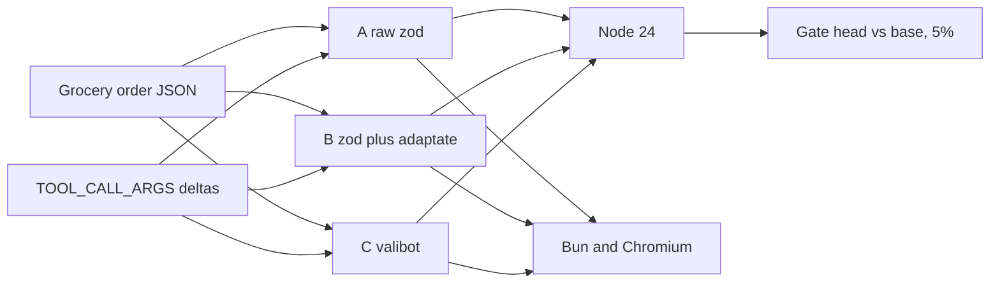

# Performance

CI compares a pull request with its base (`scripts/bench-compare.mjs`) and fails when any case is more than 5% slower (limit `1.05`). Cases: `transformSchema`, `transformPartialSchema`, `parsePartialJson`, `agUiStream`.

The [#53](https://github.com/p10ns11y/adaptate/pull/53) run reported:

| Case | Ratio (head / base) |
| --- | --- |
| `transformSchema` | 1.043 |
| `transformPartialSchema` | 1.002 |
| `parsePartialJson` | 0.989 |
| `agUiStream` | 0.996 |

[DESIGN.md](../DESIGN.md) estimates the traversal at O(N) time and O(D) space. That note is not a measured benchmark.

## A/B versus raw Zod



One grocery order, three validators. [`agree.js`](../bench/ab/agree.js) checks they accept and reject the same fixtures, including every stream chunk, before a number is kept.

```sh
pnpm --filter @adaptate/core build && node bench/ab/run.js
```

| Row | What is timed |
| --- | --- |
| Full document | One `safeParse` of a schema built once. B is one `transformSchema` of the all-optional base plus `receiptConfig`. |
| Import | Module eval plus one full-document validation. Node and Bun: a fresh process per sample, one discarded warmup, then 31 samples. Chromium: a fresh page, no discarded warmup. The browser bundle includes this harness on every variant, so the B minus A import delta cancels it. Node and Bun import the package entry. |
| Bundle | esbuild, minify, tree-shaking. Full bundle, and a second bundle with `zod` external. `effect` is always external. |

Where the work is not the same:

- AG-UI: B appends the delta, repairs JSON, builds a schema, then `safeParse`s. A and C `safeParse` a partial that was already parsed. For A and C that number is the parsed-partial number.
- Parsed partial: the same value. B builds a Zod schema on every call. A and C reuse one static all-optional schema.
- `./standard` and `./effect` are bundle rows only. The timed app does not call the effect wrapper.
- Valibot uses its own schemas for the same accept/reject rules.
- `createStreamValidator.final()` is not the full-document row. It rebuilds a schema per document.

The `ab-eval` job gates Node only, head build against the base commit, and fails above 5%: adaptate import median, full-document validations/sec, AG-UI µs/chunk, parsed-partial µs/chunk, and min plus gzip bytes for `.`, `./stream`, `./standard`, and `./effect` (full bundle and zod-external). Timings are interleaved and re-measured up to three times. Bundle bytes are not re-measured. Import p95, heap after `node --expose-gc`, the raw-zod control rows, Bun, and Chromium are uploaded with the job summary and are not gated. A positive time in B vs A is slower. A negative validations/sec is slower.

The measured table is filled from the `ab-eval` artifact of the head that publishes it.
