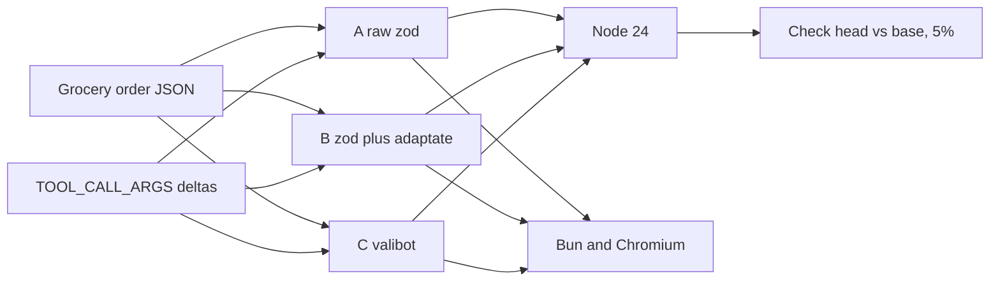

# Performance

CI compares a pull request with its base (`scripts/bench-compare.mjs`) and fails when any case is more than 5% slower (limit `1.05`). Cases: `transformSchema`, `transformPartialSchema`, `parsePartialJson`, `agUiStream`, `deepTransform`. `deepTransform` builds one 200-level object schema outside the timed loop and times `transformSchema` only.

Zod's own `safeParse` still walks a schema by recursion. The 100,000-level checks walk documents and partial JSON. They do not call it.

| Function | Walk | Reason |
| --- | --- | --- |
| `completeJson`, `parsePartialJson`, `reparseFeed` | loop | Partial JSON text can nest without bound |
| `createPartialJsonFeed` | loop | A stream chunk can deepen the same document |
| `openAPISchemaToZod`, `zodToOpenAPISchema` | loop | An OpenAPI document is runtime input |
| `dereferenceLocalDocument`, `deepMergeResolvedValue`, `documentContainsExternalRef` | loop | A local `$ref` document is runtime input |
| `transformSchema`, `extendSchema` | recursive | Schema depth is the source that declares it |
| `unwrapOptional`, `lenientSchema`, `partialSchemaFor` | recursive | Same bound. A deeper value overflows inside `safeParse` |
| `makeConditionalSchemaTransformer`, `schemasForConfigs` | one level | They do not walk nested fields |
| `isOptional` | one check | It does not walk children |

The [#53](https://github.com/p10ns11y/adaptate/pull/53) run reported:

| Case | Ratio (head / base) |
| --- | --- |
| `transformSchema` | 1.043 |
| `transformPartialSchema` | 1.002 |
| `parsePartialJson` | 0.989 |
| `agUiStream` | 0.996 |

[DESIGN.md](../DESIGN.md) estimates the traversal at O(N) time and O(D) space. That note is not a measured benchmark.

## Measured

<p align="center">
  <picture>
    <source media="(prefers-color-scheme: dark)" srcset="../assets/perf-dark.svg">
    
  </picture>
</p>

Node v24.22.3. Commit [`1a51df5`](https://github.com/p10ns11y/adaptate/commit/1a51df50ff0842213e015b18c5d4240a2e994c0a). One local `node bench/ab/run.js`. [Performance](#ab-versus-raw-zod)

`@adaptate/core/stream-incremental` tokenizes a partial JSON stream once. The grocery order is 966 characters, and `visits` is 966. A full rescan was 68,304 character visits. AG-UI on that subpath is 3.023 µs/chunk. Parsed partial is 0.835 µs/chunk against raw Zod 0.606 µs/chunk. [Incremental partial JSON](incremental-parser.md)

## A/B versus raw Zod



One grocery order, three validators. [`agree.js`](../bench/ab/agree.js) checks they accept and reject the same fixtures, including every stream chunk, before a number is kept.

```sh
pnpm --filter @adaptate/core build && node bench/ab/run.js
```

| Row | What is timed |
| --- | --- |
| Full document | One `safeParse` of a schema built once. B is one `transformSchema` of the all-optional base plus `receiptConfig`. |
| Import | Module eval plus one full-document validation. Node and Bun: a fresh process per sample, one discarded warmup, then 31 samples. Chromium: a fresh page, no discarded warmup. The browser bundle includes this harness on every variant, so the B minus A import delta cancels it. Node and Bun import the package entry. |
| Bundle | esbuild, minify, tree-shaking. Full bundle, and a second bundle with `zod` external. `effect` is always external. |

Where the work is not the same:

- AG-UI: B imports `createAgUiPartialValidator` from `@adaptate/core/stream-incremental`. Each chunk is tokenized once ([incremental scan](incremental-parser.md)), then `safeParse`s a lenient schema cached on the base schema when the value is new. A and C do not repair partial JSON. They need a complete value, so the chart marks them `no repair: needs complete JSON`. `repairMicros` clocks `parsePartialJson` from `@adaptate/core/stream` on the growing buffer, without the check. That clock is the full-prefix oracle. It is recorded and is not checked against base.
- Parsed partial: the same value. B reuses one lenient schema per base schema (`WeakMap`) and `safeParse`s it. A and C reuse one static all-optional schema. The `ab-eval` check names this row `adaptate cached partial us/chunk` and fails when head is more than 5% slower than base.
- `./standard` and `./effect` are bundle rows only. The timed app does not call the effect wrapper.
- Valibot uses its own schemas for the same accept/reject rules.
- `createStreamValidator.final()` is not the full-document row. The validator builds one `transformSchema` result per config when it is created and reuses it. A direct `transformSchema` call still builds a schema each time, which is what the full-document row does once, outside the timed loop.
- Four views per render: card, line items, delivery, and receipt. The schemas are built once. Each timed render parses the grocery order with all four. Zod and Valibot use static schemas for those fields. Adaptate calls `transformSchema` on one partial schema. The rate is renders per second (`viewsPerSec`). [`agree.js`](../bench/ab/agree.js) requires the full order to pass every view, and an empty object or a card-only object to fail. This row is recorded and is not checked against base. The README chart does not draw it.

The `ab-eval` job checks Node only, head build against the base commit, and fails above 5%: adaptate import median, full-document validations/sec, AG-UI µs/chunk (`@adaptate/core/stream-incremental`), cached parsed-partial µs/chunk, and min plus gzip bytes for `.`, `./stream`, `./stream-incremental`, `./standard`, and `./effect` (full bundle and zod-external). `./stream-incremental` is new on this line, so its base is the recorded size in `bench/ab/config.js` until a base commit contains that entry. Timings are interleaved and re-measured up to three times. Bundle bytes are not re-measured. Import p95, JSON repair, four views per render, heap after `node --expose-gc`, the raw-zod control rows, Bun, and Chromium are uploaded with the job summary and are not checked against base. A positive time in B vs A is slower. A negative validations/sec is slower.

On the same runner, the check compared `233b1ef17f994088cc5687c0c5ea61ff7a7751a9` with the base commit (no schema cache). Parsed-partial went from 178.740 µs/chunk to 0.731 µs/chunk (ratio 0.004). AG-UI went from 206.137 µs/chunk to 20.571 µs/chunk (ratio 0.100). Full-document rate went from 3120065.726/s to 3263762.591/s (ratio 1.046). Import median went from 36.832 ms to 36.476 ms (ratio 0.990). The check passed (limit 1.05).

The table below is one local `node bench/ab/run.js` of commit `1a51df50ff0842213e015b18c5d4240a2e994c0a` against raw Zod and Valibot. It is not the CI check. The AG-UI row is `createAgUiPartialValidator` from `@adaptate/core/stream-incremental`. For A and C that full push is the parsed-partial check, because they have no repair step. `repairMicros` is `parsePartialJson` on the growing buffer and is not that row.

Node v24.22.3, Bun 1.4.5, and Chromium 159.0.8154.6.

Workload: grocery order, 966 bytes, 41 `TOOL_CALL_ARGS` deltas. `deltaCharacters` is 24, and the last delta is the remainder. Import time includes module evaluation and one full-document validation. Node and Bun use a fresh process per sample, median and p95 of 31 samples after one discarded warmup. Chromium uses a fresh page per sample and no discarded warmup. Full-document and per-chunk rates are the median of 11 passes of 200 ms, one variant per process (Node, Bun) or page (Chromium). Node and Bun clocks are `process.hrtime.bigint`. The browser clock is `performance.now`.

| Metric | Runtime | A raw zod | B zod + adaptate | B vs A | C valibot |
| --- | --- | --- | --- | --- | --- |
| Import median (ms) | Node v24.22.3 | 39.744 | 41.684 | +1.939 ms (+4.879%) | 6.042 |
| Import p95 (ms) | Node v24.22.3 | 41.752 | 43.983 | +2.230 ms (+5.342%) | 7.341 |
| Full document (validations/sec) | Node v24.22.3 | 2,425,500 | 2,256,119 | -169,380 /s (-6.983%) | 472,695 |
| 4 views per render (renders/sec) | Node v24.22.3 | 1,124,133 | 484,695 | -639,438 /s (-56.883%) | 271,223 |
| AG-UI stream (µs/chunk) | Node v24.22.3 | 0.606 | 3.023 | +2.417 µs (+398.633%) | 1.409 |
| JSON repair (µs/chunk) | Node v24.22.3 | no repair: needs complete JSON | 24.076 | n/a | no repair: needs complete JSON |
| Parsed partial check, cached schema (µs/chunk) | Node v24.22.3 | 0.606 | 0.835 | +0.229 µs (+37.732%) | 1.409 |
| Heap after GC (bytes) | Node v24.22.3 | 8,322,872 | 8,510,312 | 187,440 B (+2.252%) | 5,217,008 |
| Heap delta after GC (bytes) | Node v24.22.3 | 351,048 | 389,264 | 38,216 B (+10.886%) | 52,240 |
| Import median (ms) | Bun 1.4.5 | 21.966 | 23.289 | +1.323 ms (+6.024%) | 9.014 |
| Import p95 (ms) | Bun 1.4.5 | 22.838 | 24.682 | +1.845 ms (+8.078%) | 9.509 |
| Full document (validations/sec) | Bun 1.4.5 | 1,190,317 | 1,161,432 | -28,885 /s (-2.427%) | 1,324,228 |
| 4 views per render (renders/sec) | Bun 1.4.5 | 570,205 | 221,755 | -348,450 /s (-61.110%) | 402,240 |
| AG-UI stream (µs/chunk) | Bun 1.4.5 | 0.703 | 3.036 | +2.333 µs (+331.741%) | 1.566 |
| JSON repair (µs/chunk) | Bun 1.4.5 | no repair: needs complete JSON | 18.943 | n/a | no repair: needs complete JSON |
| Parsed partial check, cached schema (µs/chunk) | Bun 1.4.5 | 0.703 | 0.920 | +0.217 µs (+30.799%) | 1.566 |
| Heap after GC (bytes) | Bun 1.4.5 | 2,109,007 | 2,392,765 | 283,758 B (+13.455%) | 670,300 |
| Heap delta after GC (bytes) | Bun 1.4.5 | 605,701 | 710,345 | 104,644 B (+17.277%) | 121,899 |
| Import median (ms) | Chromium 159.0.8154.6 | 21.900 | 22.500 | +0.600 ms (+2.740%) | 4.800 |
| Import p95 (ms) | Chromium 159.0.8154.6 | 25.200 | 24.300 | -0.900 ms (-3.571%) | 11.600 |
| Full document (validations/sec) | Chromium 159.0.8154.6 | 2,399,280 | 1,811,705 | -587,575 /s (-24.490%) | 555,445 |
| 4 views per render (renders/sec) | Chromium 159.0.8154.6 | 1,170,260 | 311,560 | -858,700 /s (-73.377%) | 332,530 |
| AG-UI stream (µs/chunk) | Chromium 159.0.8154.6 | 0.720 | 2.602 | +1.882 µs (+261.440%) | 1.084 |
| JSON repair (µs/chunk) | Chromium 159.0.8154.6 | no repair: needs complete JSON | 23.119 | n/a | no repair: needs complete JSON |
| Parsed partial check, cached schema (µs/chunk) | Chromium 159.0.8154.6 | 0.720 | 0.888 | +0.168 µs (+23.308%) | 1.084 |
| zod-only min / gzip (bytes) | esbuild 0.28.2 | 455,377 / 93,666 | — | — | baseline |
| `.` min / gzip | esbuild 0.28.2 | 455,377 / 93,666 | 456,345 / 93,976 | 968 / 310 B (+0.331% gzip) | — |
| `.` own min / gzip, zod external | esbuild 0.28.2 | — | 2,490 / 1,207 | +2,490 / +1,207 B | — |
| `./stream` min / gzip | esbuild 0.28.2 | 455,377 / 93,666 | 458,164 / 94,634 | 2,787 / 968 B (+1.033% gzip) | — |
| `./stream` own min / gzip, zod external | esbuild 0.28.2 | — | 4,278 / 1,926 | +4,278 / +1,926 B | — |
| `./standard` min / gzip | esbuild 0.28.2 | — | 589 / 328 | 589 / 328 B | — |
| `./standard` own min / gzip, zod external | esbuild 0.28.2 | — | 589 / 328 | +589 / +328 B | — |
| `./stream-incremental` min / gzip | esbuild 0.28.2 | 455,377 / 93,666 | 461,003 / 95,833 | 5,626 / 2,167 B (+2.314% gzip) | — |
| `./stream-incremental` own min / gzip, zod external | esbuild 0.28.2 | — | 7,056 / 3,094 | +7,056 / +3,094 B | — |
| `./effect` min / gzip, effect external | esbuild 0.28.2 | 455,377 / 93,666 | 458,129 / 94,369 | 2,752 / 703 B (+0.751% gzip) | — |
| `./effect` own min / gzip, zod external, effect external | esbuild 0.28.2 | — | 4,221 / 1,713 | +4,221 / +1,713 B | — |

`@adaptate/core/stream-incremental` reads each character of that grocery order once. Partial JSON tests assert `visits` equals the text length. [`scripts/render-perf-chart.mjs`](../scripts/render-perf-chart.mjs) reads [`assets/perf-run.json`](../assets/perf-run.json) and fails if a field is missing.

## Credit

Measure first, then optimize only the critical path. Donald E. Knuth, "Structured Programming with go to Statements", ACM Computing Surveys 6(4), 1974:

> We should forget about small efficiencies, say about 97% of the time: premature optimization is the root of all evil. Yet we should not pass up our opportunities in that critical 3%.

The per-chunk re-parse was that critical 3% here: [10.1145/356635.356640](https://doi.org/10.1145/356635.356640). Section 2 (pp. 280-285) replaces nested calls with loops and an explicit stack, so a document nested without bound does not overflow the host call stack.
