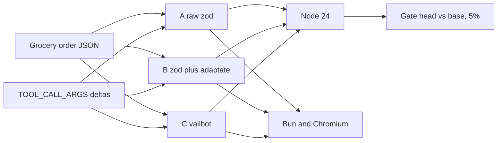

# Performance

CI compares a pull request with its base (`scripts/bench-compare.mjs`) and fails when any case is more than 5% slower (limit `1.05`). Cases: `transformSchema`, `transformPartialSchema`, `parsePartialJson`, `agUiStream`.

The [#53](https://github.com/p10ns11y/adaptate/pull/53) run reported:

| Case | Ratio (head / base) |
| --- | --- |
| `transformSchema` | 1.043 |
| `transformPartialSchema` | 1.002 |
| `parsePartialJson` | 0.989 |
| `agUiStream` | 0.996 |

[DESIGN.md](../DESIGN.md) estimates the traversal at O(N) time and O(D) space. That note is not a measured benchmark.

## A/B versus raw Zod



One grocery order, three validators. [`agree.js`](../bench/ab/agree.js) checks they accept and reject the same fixtures, including every stream chunk, before a number is kept.

```sh
pnpm --filter @adaptate/core build && node bench/ab/run.js
```

| Row | What is timed |
| --- | --- |
| Full document | One `safeParse` of a schema built once. B is one `transformSchema` of the all-optional base plus `receiptConfig`. |
| Import | Module eval plus one full-document validation. Node and Bun: a fresh process per sample, one discarded warmup, then 31 samples. Chromium: a fresh page, no discarded warmup. The browser bundle includes this harness on every variant, so the B minus A import delta cancels it. Node and Bun import the package entry. |
| Bundle | esbuild, minify, tree-shaking. Full bundle, and a second bundle with `zod` external. `effect` is always external. |

Where the work is not the same:

- AG-UI: B appends the delta, repairs JSON, builds a schema, then `safeParse`s. A and C `safeParse` a partial that was already parsed. For A and C that number is the parsed-partial number.
- Parsed partial: the same value. B builds a Zod schema on every call. A and C reuse one static all-optional schema.
- `./standard` and `./effect` are bundle rows only. The timed app does not call the effect wrapper.
- Valibot uses its own schemas for the same accept/reject rules.
- `createStreamValidator.final()` is not the full-document row. It rebuilds a schema per document.

The `ab-eval` job gates Node only, head build against the base commit, and fails above 5%: adaptate import median, full-document validations/sec, AG-UI µs/chunk, parsed-partial µs/chunk, and min plus gzip bytes for `.`, `./stream`, `./standard`, and `./effect` (full bundle and zod-external). Timings are interleaved and re-measured up to three times. Bundle bytes are not re-measured. Import p95, heap after `node --expose-gc`, the raw-zod control rows, Bun, and Chromium are uploaded with the job summary and are not gated. A positive time in B vs A is slower. A negative validations/sec is slower.

Node 24.22.3, Bun 1.4.5, and Chromium 159.0.8154.6 on `f23a03962d1a0ec7bd7879568001be81136651f4`, job [ab-eval](https://github.com/p10ns11y/adaptate/actions/runs/44951753156), artifact `ab-eval-results`.

Workload: grocery order, 966 bytes, 41 `TOOL_CALL_ARGS` deltas of 24 characters. Import time includes module evaluation and one full-document validation. Node and Bun use a fresh process per sample, median and p95 of 31 samples after one discarded warmup. Chromium uses a fresh page per sample and no discarded warmup. Full-document and per-chunk rates are the median of 11 passes of 200 ms, one variant per process (Node, Bun) or page (Chromium). Node and Bun clocks are `process.hrtime.bigint`. The browser clock is `performance.now`.

| Metric | Runtime | A raw zod | B zod + adaptate | B vs A | C valibot |
| --- | --- | --- | --- | --- | --- |
| Import median (ms) | Node v24.22.3 | 51.930 | 54.384 | +2.454 ms (+4.726%) | 7.318 |
| Import p95 (ms) | Node v24.22.3 | 55.196 | 63.148 | +7.953 ms (+14.408%) | 8.285 |
| Full document (validations/sec) | Node v24.22.3 | 2,235,727 | 2,003,243 | -232,483 /s (-10.399%) | 419,311 |
| AG-UI stream (µs/chunk) | Node v24.22.3 | 0.685 | 297.673 | +296.988 µs (+43336.758%) | 1.558 |
| Parsed partial check (µs/chunk) | Node v24.22.3 | 0.685 | 290.860 | +290.175 µs (+42342.549%) | 1.558 |
| Heap after GC (bytes) | Node v24.22.3 | 8,292,232 | 8,572,648 | 280,416 B (+3.382%) | 5,205,240 |
| Heap delta after GC (bytes) | Node v24.22.3 | 356,512 | 523,648 | 167,136 B (+46.881%) | 52,024 |
| Import median (ms) | Bun 1.4.5 | 29.076 | 31.349 | +2.273 ms (+7.816%) | 13.209 |
| Import p95 (ms) | Bun 1.4.5 | 33.840 | 35.488 | +1.648 ms (+4.871%) | 13.694 |
| Full document (validations/sec) | Bun 1.4.5 | 1,014,413 | 969,934 | -44,479 /s (-4.385%) | 1,146,364 |
| AG-UI stream (µs/chunk) | Bun 1.4.5 | 0.848 | 385.128 | +384.281 µs (+45334.267%) | 1.373 |
| Parsed partial check (µs/chunk) | Bun 1.4.5 | 0.848 | 344.067 | +343.220 µs (+40490.249%) | 1.373 |
| Heap after GC (bytes) | Bun 1.4.5 | 2,086,733 | 2,361,609 | 274,876 B (+13.173%) | 670,787 |
| Heap delta after GC (bytes) | Bun 1.4.5 | 603,557 | 795,561 | 192,004 B (+31.812%) | 122,238 |
| Import median (ms) | Chromium 159.0.8154.6 | 30.800 | 31.500 | +0.700 ms (+2.273%) | 7.900 |
| Import p95 (ms) | Chromium 159.0.8154.6 | 34.100 | 34.900 | +0.800 ms (+2.346%) | 15.400 |
| Full document (validations/sec) | Chromium 159.0.8154.6 | 2,007,665 | 1,913,265 | -94,400 /s (-4.702%) | 452,055 |
| AG-UI stream (µs/chunk) | Chromium 159.0.8154.6 | 0.843 | 194.841 | +193.997 µs (+23010.619%) | 1.333 |
| Parsed partial check (µs/chunk) | Chromium 159.0.8154.6 | 0.843 | 171.320 | +170.477 µs (+20220.831%) | 1.333 |
| zod-only min / gzip (bytes) | esbuild 0.28.2 | 455,377 / 93,666 | — | — | baseline |
| `.` min / gzip | esbuild 0.28.2 | 455,377 / 93,666 | 456,345 / 93,976 | 968 / 310 B (+0.331% gzip) | — |
| `.` own min / gzip, zod external | esbuild 0.28.2 | — | 2,490 / 1,207 | +2,490 / +1,207 B | — |
| `./stream` min / gzip | esbuild 0.28.2 | 455,377 / 93,666 | 458,189 / 94,590 | 2,812 / 924 B (+0.986% gzip) | — |
| `./stream` own min / gzip, zod external | esbuild 0.28.2 | — | 4,303 / 1,900 | +4,303 / +1,900 B | — |
| `./standard` min / gzip | esbuild 0.28.2 | — | 589 / 328 | 589 / 328 B | — |
| `./standard` own min / gzip, zod external | esbuild 0.28.2 | — | 589 / 328 | +589 / +328 B | — |
| `./effect` min / gzip, effect external | esbuild 0.28.2 | 455,377 / 93,666 | 458,189 / 94,307 | 2,812 / 641 B (+0.684% gzip) | — |
| `./effect` own min / gzip, zod external, effect external | esbuild 0.28.2 | — | 4,280 / 1,681 | +4,280 / +1,681 B | — |

Gate on that run: PASS (limit 1.05).
