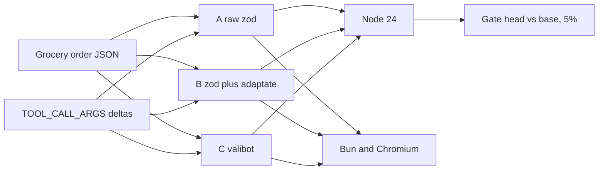

# Performance

CI compares a pull request with its base (`scripts/bench-compare.mjs`) and fails when any case is more than 5% slower (limit `1.05`). Cases: `transformSchema`, `transformPartialSchema`, `parsePartialJson`, `agUiStream`.

The [#53](https://github.com/p10ns11y/adaptate/pull/53) run reported:

| Case | Ratio (head / base) |
| --- | --- |
| `transformSchema` | 1.043 |
| `transformPartialSchema` | 1.002 |
| `parsePartialJson` | 0.989 |
| `agUiStream` | 0.996 |

[DESIGN.md](../DESIGN.md) estimates the traversal at O(N) time and O(D) space. That note is not a measured benchmark.

## A/B versus raw Zod



One grocery order, three validators. [`agree.js`](../bench/ab/agree.js) checks they accept and reject the same fixtures, including every stream chunk, before a number is kept.

```sh
pnpm --filter @adaptate/core build && node bench/ab/run.js
```

| Row | What is timed |
| --- | --- |
| Full document | One `safeParse` of a schema built once. B is one `transformSchema` of the all-optional base plus `receiptConfig`. |
| Import | Module eval plus one full-document validation. Node and Bun: a fresh process per sample, one discarded warmup, then 31 samples. Chromium: a fresh page, no discarded warmup. The browser bundle includes this harness on every variant, so the B minus A import delta cancels it. Node and Bun import the package entry. |
| Bundle | esbuild, minify, tree-shaking. Full bundle, and a second bundle with `zod` external. `effect` is always external. |

Where the work is not the same:

- AG-UI: B appends the delta, repairs JSON with `parsePartialJson` on the whole buffer, then `safeParse`s a lenient schema cached on the base schema. A and C `safeParse` a partial that was already parsed. For A and C that number is the parsed-partial number. JSON repair is the AG-UI row minus the parsed-partial row. That difference is two medians, not a separate clock, and it is not gated.
- Parsed partial: the same value. B reuses one lenient schema per base schema (`WeakMap`) and `safeParse`s it. A and C reuse one static all-optional schema. The `ab-eval` gate names this row `adaptate cached partial us/chunk` and fails when head is more than 5% slower than base.
- `./standard` and `./effect` are bundle rows only. The timed app does not call the effect wrapper.
- Valibot uses its own schemas for the same accept/reject rules.
- `createStreamValidator.final()` is not the full-document row. The validator builds one `transformSchema` result per config when it is created and reuses it. A direct `transformSchema` call still builds a schema each time, which is what the full-document row does once, outside the timed loop.

The `ab-eval` job gates Node only, head build against the base commit, and fails above 5%: adaptate import median, full-document validations/sec, AG-UI µs/chunk, cached parsed-partial µs/chunk, and min plus gzip bytes for `.`, `./stream`, `./standard`, and `./effect` (full bundle and zod-external). Timings are interleaved and re-measured up to three times. Bundle bytes are not re-measured. Import p95, heap after `node --expose-gc`, the raw-zod control rows, Bun, and Chromium are uploaded with the job summary and are not gated. A positive time in B vs A is slower. A negative validations/sec is slower.

The table below is the measurement before the schema cache, on `a804cdb5df11a48820b40dd75b8751622bc2cd9e`, job [ab-eval](https://github.com/p10ns11y/adaptate/actions/runs/44952593670).

Node 24.22.3, Bun 1.4.5, and Chromium 159.0.8154.6 on `a804cdb5df11a48820b40dd75b8751622bc2cd9e`, job [ab-eval](https://github.com/p10ns11y/adaptate/actions/runs/44952593670), artifact `ab-eval-results`.

Workload: grocery order, 966 bytes, 41 `TOOL_CALL_ARGS` deltas of 24 characters. Import time includes module evaluation and one full-document validation. Node and Bun use a fresh process per sample, median and p95 of 31 samples after one discarded warmup. Chromium uses a fresh page per sample and no discarded warmup. Full-document and per-chunk rates are the median of 11 passes of 200 ms, one variant per process (Node, Bun) or page (Chromium). Node and Bun clocks are `process.hrtime.bigint`. The browser clock is `performance.now`.

| Metric | Runtime | A raw zod | B zod + adaptate | B vs A | C valibot |
| --- | --- | --- | --- | --- | --- |
| Import median (ms) | Node v24.22.3 | 41.317 | 45.205 | +3.888 ms (+9.411%) | 6.463 |
| Import p95 (ms) | Node v24.22.3 | 44.661 | 47.089 | +2.428 ms (+5.437%) | 6.598 |
| Full document (validations/sec) | Node v24.22.3 | 2,528,938 | 2,330,147 | -198,791 /s (-7.861%) | 487,005 |
| AG-UI stream (µs/chunk) | Node v24.22.3 | 0.599 | 256.586 | +255.987 µs (+42724.548%) | 1.405 |
| Parsed partial check (µs/chunk) | Node v24.22.3 | 0.599 | 234.051 | +233.452 µs (+38963.473%) | 1.405 |
| Heap after GC (bytes) | Node v24.22.3 | 8,283,184 | 8,572,576 | 289,392 B (+3.494%) | 5,203,768 |
| Heap delta after GC (bytes) | Node v24.22.3 | 347,400 | 523,480 | 176,080 B (+50.685%) | 50,552 |
| Import median (ms) | Bun 1.4.5 | 25.649 | 26.471 | +0.823 ms (+3.208%) | 12.104 |
| Import p95 (ms) | Bun 1.4.5 | 33.706 | 35.690 | +1.984 ms (+5.886%) | 13.335 |
| Full document (validations/sec) | Bun 1.4.5 | 1,199,214 | 1,193,422 | -5,792 /s (-0.483%) | 1,180,162 |
| AG-UI stream (µs/chunk) | Bun 1.4.5 | 0.739 | 315.392 | +314.653 µs (+42580.631%) | 1.355 |
| Parsed partial check (µs/chunk) | Bun 1.4.5 | 0.739 | 278.191 | +277.452 µs (+37546.332%) | 1.355 |
| Heap after GC (bytes) | Bun 1.4.5 | 2,086,621 | 2,361,465 | 274,844 B (+13.172%) | 665,486 |
| Heap delta after GC (bytes) | Bun 1.4.5 | 603,557 | 795,529 | 191,972 B (+31.807%) | 117,082 |
| Import median (ms) | Chromium 159.0.8154.6 | 29.600 | 30.500 | +0.900 ms (+3.041%) | 8.300 |
| Import p95 (ms) | Chromium 159.0.8154.6 | 33.800 | 32.800 | -1.000 ms (-2.959%) | 15.300 |
| Full document (validations/sec) | Chromium 159.0.8154.6 | 2,363,050 | 2,182,385 | -180,665 /s (-7.645%) | 593,380 |
| AG-UI stream (µs/chunk) | Chromium 159.0.8154.6 | 0.712 | 177.526 | +176.814 µs (+24836.386%) | 1.068 |
| Parsed partial check (µs/chunk) | Chromium 159.0.8154.6 | 0.712 | 160.268 | +159.556 µs (+22412.135%) | 1.068 |
| zod-only min / gzip (bytes) | esbuild 0.28.2 | 455,377 / 93,666 | — | — | baseline |
| `.` min / gzip | esbuild 0.28.2 | 455,377 / 93,666 | 456,345 / 93,976 | 968 / 310 B (+0.331% gzip) | — |
| `.` own min / gzip, zod external | esbuild 0.28.2 | — | 2,490 / 1,207 | +2,490 / +1,207 B | — |
| `./stream` min / gzip | esbuild 0.28.2 | 455,377 / 93,666 | 458,189 / 94,590 | 2,812 / 924 B (+0.986% gzip) | — |
| `./stream` own min / gzip, zod external | esbuild 0.28.2 | — | 4,303 / 1,900 | +4,303 / +1,900 B | — |
| `./standard` min / gzip | esbuild 0.28.2 | — | 589 / 328 | 589 / 328 B | — |
| `./standard` own min / gzip, zod external | esbuild 0.28.2 | — | 589 / 328 | +589 / +328 B | — |
| `./effect` min / gzip, effect external | esbuild 0.28.2 | 455,377 / 93,666 | 458,189 / 94,307 | 2,812 / 641 B (+0.684% gzip) | — |
| `./effect` own min / gzip, zod external, effect external | esbuild 0.28.2 | — | 4,280 / 1,681 | +4,280 / +1,681 B | — |

Gate on that run: PASS (limit 1.05).
