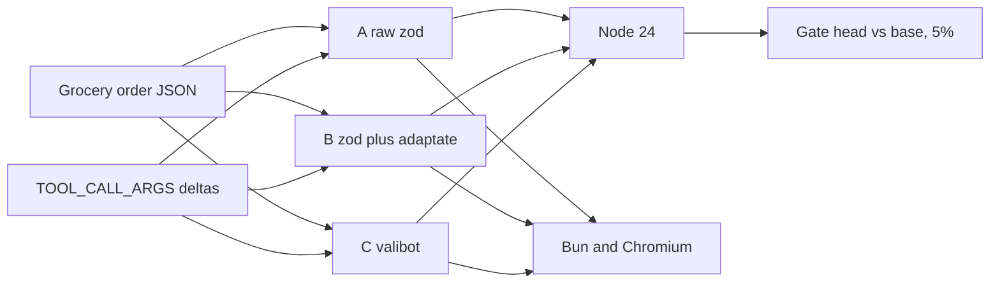

# Performance

CI compares a pull request with its base (`scripts/bench-compare.mjs`) and fails when any case is more than 5% slower (limit `1.05`). Cases: `transformSchema`, `transformPartialSchema`, `parsePartialJson`, `agUiStream`.

The [#53](https://github.com/p10ns11y/adaptate/pull/53) run reported:

| Case | Ratio (head / base) |
| --- | --- |
| `transformSchema` | 1.043 |
| `transformPartialSchema` | 1.002 |
| `parsePartialJson` | 0.989 |
| `agUiStream` | 0.996 |

[DESIGN.md](../DESIGN.md) estimates the traversal at O(N) time and O(D) space. That note is not a measured benchmark.

## A/B versus raw Zod



One grocery order, three validators. [`agree.js`](../bench/ab/agree.js) checks they accept and reject the same fixtures, including every stream chunk, before a number is kept.

```sh
pnpm --filter @adaptate/core build && node bench/ab/run.js
```

| Row | What is timed |
| --- | --- |
| Full document | One `safeParse` of a schema built once. B is one `transformSchema` of the all-optional base plus `receiptConfig`. |
| Import | Module eval plus one full-document validation. Node and Bun: a fresh process per sample, one discarded warmup, then 31 samples. Chromium: a fresh page, no discarded warmup. The browser bundle includes this harness on every variant, so the B minus A import delta cancels it. Node and Bun import the package entry. |
| Bundle | esbuild, minify, tree-shaking. Full bundle, and a second bundle with `zod` external. `effect` is always external. |

Where the work is not the same:

- AG-UI: B appends the delta, repairs JSON, builds a schema, then `safeParse`s. A and C `safeParse` a partial that was already parsed. For A and C that number is the parsed-partial number.
- Parsed partial: the same value. B builds a Zod schema on every call. A and C reuse one static all-optional schema.
- `./standard` and `./effect` are bundle rows only. The timed app does not call the effect wrapper.
- Valibot uses its own schemas for the same accept/reject rules.
- `createStreamValidator.final()` is not the full-document row. It rebuilds a schema per document.

The `ab-eval` job gates Node only, head build against the base commit, and fails above 5%: adaptate import median, full-document validations/sec, AG-UI µs/chunk, parsed-partial µs/chunk, and min plus gzip bytes for `.`, `./stream`, `./standard`, and `./effect` (full bundle and zod-external). Timings are interleaved and re-measured up to three times. Bundle bytes are not re-measured. Import p95, heap after `node --expose-gc`, the raw-zod control rows, Bun, and Chromium are uploaded with the job summary and are not gated. A positive time in B vs A is slower. A negative validations/sec is slower.

Node 24.22.3, Bun 1.4.5, and Chromium 159.0.8154.6 on `f2d303e8aeec36dd8702cc50b8addc987549eada`, job [ab-eval](https://github.com/p10ns11y/adaptate/actions/runs/44952056064), artifact `ab-eval-results`.

Workload: grocery order, 966 bytes, 41 `TOOL_CALL_ARGS` deltas of 24 characters. Import time includes module evaluation and one full-document validation. Node and Bun use a fresh process per sample, median and p95 of 31 samples after one discarded warmup. Chromium uses a fresh page per sample and no discarded warmup. Full-document and per-chunk rates are the median of 11 passes of 200 ms, one variant per process (Node, Bun) or page (Chromium). Node and Bun clocks are `process.hrtime.bigint`. The browser clock is `performance.now`.

| Metric | Runtime | A raw zod | B zod + adaptate | B vs A | C valibot |
| --- | --- | --- | --- | --- | --- |
| Import median (ms) | Node v24.22.3 | 50.532 | 52.858 | +2.326 ms (+4.603%) | 6.935 |
| Import p95 (ms) | Node v24.22.3 | 52.203 | 54.487 | +2.283 ms (+4.374%) | 7.180 |
| Full document (validations/sec) | Node v24.22.3 | 2,197,688 | 1,980,122 | -217,566 /s (-9.900%) | 423,795 |
| AG-UI stream (µs/chunk) | Node v24.22.3 | 0.682 | 290.697 | +290.015 µs (+42543.485%) | 1.549 |
| Parsed partial check (µs/chunk) | Node v24.22.3 | 0.682 | 260.769 | +260.088 µs (+38153.314%) | 1.549 |
| Heap after GC (bytes) | Node v24.22.3 | 8,292,272 | 8,572,656 | 280,384 B (+3.381%) | 5,205,240 |
| Heap delta after GC (bytes) | Node v24.22.3 | 356,584 | 523,536 | 166,952 B (+46.820%) | 52,024 |
| Import median (ms) | Bun 1.4.5 | 28.433 | 30.033 | +1.600 ms (+5.628%) | 12.154 |
| Import p95 (ms) | Bun 1.4.5 | 34.683 | 33.297 | -1.386 ms (-3.998%) | 13.582 |
| Full document (validations/sec) | Bun 1.4.5 | 1,055,357 | 971,457 | -83,900 /s (-7.950%) | 1,206,869 |
| AG-UI stream (µs/chunk) | Bun 1.4.5 | 0.807 | 314.079 | +313.272 µs (+38816.686%) | 1.337 |
| Parsed partial check (µs/chunk) | Bun 1.4.5 | 0.807 | 281.885 | +281.078 µs (+34827.525%) | 1.337 |
| Heap after GC (bytes) | Bun 1.4.5 | 2,086,915 | 2,361,577 | 274,662 B (+13.161%) | 670,191 |
| Heap delta after GC (bytes) | Bun 1.4.5 | 603,739 | 795,529 | 191,790 B (+31.767%) | 122,010 |
| Import median (ms) | Chromium 159.0.8154.6 | 29.800 | 30.100 | +0.300 ms (+1.007%) | 7.400 |
| Import p95 (ms) | Chromium 159.0.8154.6 | 34.100 | 33.400 | -0.700 ms (-2.053%) | 15.400 |
| Full document (validations/sec) | Chromium 159.0.8154.6 | 1,974,570 | 1,902,690 | -71,880 /s (-3.640%) | 446,540 |
| AG-UI stream (µs/chunk) | Chromium 159.0.8154.6 | 0.836 | 189.024 | +188.188 µs (+22510.625%) | 1.331 |
| Parsed partial check (µs/chunk) | Chromium 159.0.8154.6 | 0.836 | 161.762 | +160.926 µs (+19249.613%) | 1.331 |
| zod-only min / gzip (bytes) | esbuild 0.28.2 | 455,377 / 93,666 | — | — | baseline |
| `.` min / gzip | esbuild 0.28.2 | 455,377 / 93,666 | 456,345 / 93,976 | 968 / 310 B (+0.331% gzip) | — |
| `.` own min / gzip, zod external | esbuild 0.28.2 | — | 2,490 / 1,207 | +2,490 / +1,207 B | — |
| `./stream` min / gzip | esbuild 0.28.2 | 455,377 / 93,666 | 458,189 / 94,590 | 2,812 / 924 B (+0.986% gzip) | — |
| `./stream` own min / gzip, zod external | esbuild 0.28.2 | — | 4,303 / 1,900 | +4,303 / +1,900 B | — |
| `./standard` min / gzip | esbuild 0.28.2 | — | 589 / 328 | 589 / 328 B | — |
| `./standard` own min / gzip, zod external | esbuild 0.28.2 | — | 589 / 328 | +589 / +328 B | — |
| `./effect` min / gzip, effect external | esbuild 0.28.2 | 455,377 / 93,666 | 458,189 / 94,307 | 2,812 / 641 B (+0.684% gzip) | — |
| `./effect` own min / gzip, zod external, effect external | esbuild 0.28.2 | — | 4,280 / 1,681 | +4,280 / +1,681 B | — |

Gate on that run: PASS (limit 1.05).
