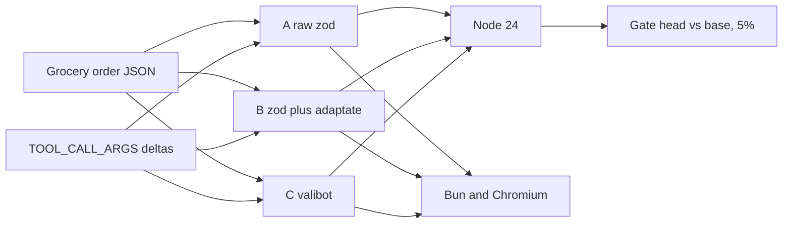

# Performance

CI compares a pull request with its base (`scripts/bench-compare.mjs`) and fails when any case is more than 5% slower (limit `1.05`). Cases: `transformSchema`, `transformPartialSchema`, `parsePartialJson`, `agUiStream`.

The [#53](https://github.com/p10ns11y/adaptate/pull/53) run reported:

| Case | Ratio (head / base) |
| --- | --- |
| `transformSchema` | 1.043 |
| `transformPartialSchema` | 1.002 |
| `parsePartialJson` | 0.989 |
| `agUiStream` | 0.996 |

[DESIGN.md](../DESIGN.md) estimates the traversal at O(N) time and O(D) space. That note is not a measured benchmark.

## A/B versus raw Zod



One grocery order, three validators. [`agree.js`](../bench/ab/agree.js) checks they accept and reject the same fixtures, including every stream chunk, before a number is kept.

```sh
pnpm --filter @adaptate/core build && node bench/ab/run.js
```

| Row | What is timed |
| --- | --- |
| Full document | One `safeParse` of a schema built once. B is one `transformSchema` of the all-optional base plus `receiptConfig`. |
| Import | Module eval plus one full-document validation. Node and Bun: a fresh process per sample, one discarded warmup, then 31 samples. Chromium: a fresh page, no discarded warmup. The browser bundle includes this harness on every variant, so the B minus A import delta cancels it. Node and Bun import the package entry. |
| Bundle | esbuild, minify, tree-shaking. Full bundle, and a second bundle with `zod` external. `effect` is always external. |

Where the work is not the same:

- AG-UI: B appends the delta and resumes the partial-JSON scan from the previous chunk ([incremental scan](incremental-parser.md)), then `safeParse`s a lenient schema cached on the base schema when the value is new. A and C do not repair partial JSON. They need a complete value, so the chart marks them `no repair: needs complete JSON`. `repairMicros` clocks `parsePartialJson` on the growing buffer, without the check. That clock is the full-prefix oracle. It is recorded and is not gated.
- Parsed partial: the same value. B reuses one lenient schema per base schema (`WeakMap`) and `safeParse`s it. A and C reuse one static all-optional schema. The `ab-eval` gate names this row `adaptate cached partial us/chunk` and fails when head is more than 5% slower than base.
- `./standard` and `./effect` are bundle rows only. The timed app does not call the effect wrapper.
- Valibot uses its own schemas for the same accept/reject rules.
- `createStreamValidator.final()` is not the full-document row. The validator builds one `transformSchema` result per config when it is created and reuses it. A direct `transformSchema` call still builds a schema each time, which is what the full-document row does once, outside the timed loop.
- Four views per render: card, line items, delivery, and receipt. The schemas are built once. Each timed render parses the grocery order with all four. Zod and Valibot use static schemas for those fields. Adaptate calls `transformSchema` on one partial schema. The rate is renders per second (`viewsPerSec`). [`agree.js`](../bench/ab/agree.js) requires the full order to pass every view, and an empty object or a card-only object to fail. This row is recorded and is not gated. The README chart does not draw it.

The `ab-eval` job gates Node only, head build against the base commit, and fails above 5%: adaptate import median, full-document validations/sec, AG-UI µs/chunk, cached parsed-partial µs/chunk, and min plus gzip bytes for `.`, `./stream`, `./standard`, and `./effect` (full bundle and zod-external). Timings are interleaved and re-measured up to three times. Bundle bytes are not re-measured. Import p95, JSON repair, four views per render, heap after `node --expose-gc`, the raw-zod control rows, Bun, and Chromium are uploaded with the job summary and are not gated. A positive time in B vs A is slower. A negative validations/sec is slower.

On the same runner, the gate compared `233b1ef17f994088cc5687c0c5ea61ff7a7751a9` with the base commit (no schema cache). Parsed-partial went from 178.740 µs/chunk to 0.731 µs/chunk (ratio 0.004). AG-UI went from 206.137 µs/chunk to 20.571 µs/chunk (ratio 0.100). Full-document rate went from 3120065.726/s to 3263762.591/s (ratio 1.046). Import median went from 36.832 ms to 36.476 ms (ratio 0.990). The gate passed (limit 1.05).

The table below is one local `node bench/ab/run.js` of commit `168260132fe4953548a28a2c3e167a3fdf93305d` against raw Zod and Valibot. It is not the gate. The AG-UI row is the full push. For A and C that full push is the parsed-partial check, because they have no repair step. `repairMicros` is `parsePartialJson` on the growing buffer and is not that row.

Node v24.22.3, Bun 1.4.5, and Chromium 159.0.8154.6.

Workload: grocery order, 966 bytes, 41 `TOOL_CALL_ARGS` deltas of 24 characters. Import time includes module evaluation and one full-document validation. Node and Bun use a fresh process per sample, median and p95 of 31 samples after one discarded warmup. Chromium uses a fresh page per sample and no discarded warmup. Full-document and per-chunk rates are the median of 11 passes of 200 ms, one variant per process (Node, Bun) or page (Chromium). Node and Bun clocks are `process.hrtime.bigint`. The browser clock is `performance.now`.

| Metric | Runtime | A raw zod | B zod + adaptate | B vs A | C valibot |
| --- | --- | --- | --- | --- | --- |
| Import median (ms) | Node v24.22.3 | 40.397 | 42.197 | +1.800 ms (+4.455%) | 6.124 |
| Import p95 (ms) | Node v24.22.3 | 43.603 | 44.154 | +0.551 ms (+1.263%) | 6.458 |
| Full document (validations/sec) | Node v24.22.3 | 2,466,896 | 2,262,696 | -204,200 /s (-8.278%) | 455,096 |
| 4 views per render (renders/sec) | Node v24.22.3 | 1,155,246 | 481,743 | -673,503 /s (-58.300%) | 255,243 |
| AG-UI stream (µs/chunk) | Node v24.22.3 | 0.628 | 3.073 | +2.445 µs (+389.248%) | 1.506 |
| JSON repair (µs/chunk) | Node v24.22.3 | no repair: needs complete JSON | 24.034 | n/a | no repair: needs complete JSON |
| Parsed partial check, cached schema (µs/chunk) | Node v24.22.3 | 0.628 | 0.842 | +0.214 µs (+34.050%) | 1.506 |
| Heap after GC (bytes) | Node v24.22.3 | 8,320,768 | 8,500,248 | 179,480 B (+2.157%) | 5,214,848 |
| Heap delta after GC (bytes) | Node v24.22.3 | 351,048 | 388,912 | 37,864 B (+10.786%) | 52,256 |
| Import median (ms) | Bun 1.4.5 | 22.120 | 23.623 | +1.503 ms (+6.796%) | 9.180 |
| Import p95 (ms) | Bun 1.4.5 | 23.246 | 25.123 | +1.877 ms (+8.076%) | 9.771 |
| Full document (validations/sec) | Bun 1.4.5 | 1,226,295 | 1,193,560 | -32,735 /s (-2.669%) | 1,333,832 |
| 4 views per render (renders/sec) | Bun 1.4.5 | 589,858 | 220,063 | -369,796 /s (-62.692%) | 397,618 |
| AG-UI stream (µs/chunk) | Bun 1.4.5 | 0.695 | 3.097 | +2.403 µs (+345.924%) | 1.327 |
| JSON repair (µs/chunk) | Bun 1.4.5 | no repair: needs complete JSON | 19.198 | n/a | no repair: needs complete JSON |
| Parsed partial check, cached schema (µs/chunk) | Bun 1.4.5 | 0.695 | 0.959 | +0.265 µs (+38.122%) | 1.327 |
| Heap after GC (bytes) | Bun 1.4.5 | 2,108,538 | 2,386,088 | 277,550 B (+13.163%) | 664,738 |
| Heap delta after GC (bytes) | Bun 1.4.5 | 606,134 | 711,040 | 104,906 B (+17.307%) | 118,582 |
| Import median (ms) | Chromium 159.0.8154.6 | 22.200 | 22.900 | +0.700 ms (+3.153%) | 4.800 |
| Import p95 (ms) | Chromium 159.0.8154.6 | 24.000 | 26.300 | +2.300 ms (+9.583%) | 6.000 |
| Full document (validations/sec) | Chromium 159.0.8154.6 | 2,356,760 | 1,840,670 | -516,090 /s (-21.898%) | 600,505 |
| 4 views per render (renders/sec) | Chromium 159.0.8154.6 | 1,151,985 | 303,530 | -848,455 /s (-73.652%) | 335,460 |
| AG-UI stream (µs/chunk) | Chromium 159.0.8154.6 | 0.740 | 2.642 | +1.903 µs (+257.259%) | 1.071 |
| JSON repair (µs/chunk) | Chromium 159.0.8154.6 | no repair: needs complete JSON | 23.287 | n/a | no repair: needs complete JSON |
| Parsed partial check, cached schema (µs/chunk) | Chromium 159.0.8154.6 | 0.740 | 0.913 | +0.173 µs (+23.409%) | 1.071 |
| zod-only min / gzip (bytes) | esbuild 0.28.2 | 455,377 / 93,666 | — | — | baseline |
| `.` min / gzip | esbuild 0.28.2 | 455,377 / 93,666 | 456,345 / 93,976 | 968 / 310 B (+0.331% gzip) | — |
| `.` own min / gzip, zod external | esbuild 0.28.2 | — | 2,490 / 1,207 | +2,490 / +1,207 B | — |
| `./stream` min / gzip | esbuild 0.28.2 | 455,377 / 93,666 | 460,935 / 95,817 | 5,558 / 2,151 B (+2.296% gzip) | — |
| `./stream` own min / gzip, zod external | esbuild 0.28.2 | — | 6,987 / 3,065 | +6,987 / +3,065 B | — |
| `./standard` min / gzip | esbuild 0.28.2 | — | 589 / 328 | 589 / 328 B | — |
| `./standard` own min / gzip, zod external | esbuild 0.28.2 | — | 589 / 328 | +589 / +328 B | — |
| `./effect` min / gzip, effect external | esbuild 0.28.2 | 455,377 / 93,666 | 460,900 / 95,536 | 5,523 / 1,870 B (+1.996% gzip) | — |
| `./effect` own min / gzip, zod external, effect external | esbuild 0.28.2 | — | 6,936 / 2,851 | +6,936 / +2,851 B | — |

The tokenizer reads each character of that grocery order once: 966 visits. A full rescan of the buffer was 68,304 character visits. [`scripts/render-perf-chart.mjs`](../scripts/render-perf-chart.mjs) reads [`assets/perf-run.json`](../assets/perf-run.json) and fails if a field is missing.
