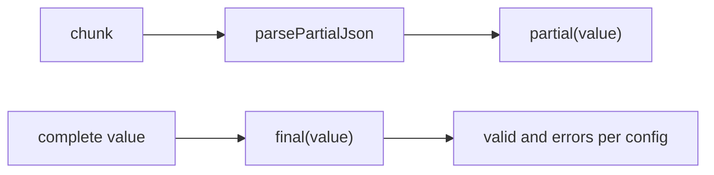

# Streaming

`@adaptate/core/stream` checks a partial document against each named config while text is still arriving. `zod` is the only peer.



`parsePartialJson(text)` closes open strings, objects, and arrays, then parses the longest prefix. It returns `undefined` when nothing parses.

`createStreamValidator(schema, configs)`:

| Method | What it checks | Cache |
| --- | --- | --- |
| `partial(value)` | Present fields only. Absent fields stay optional. Every named config gets the same check. | Lenient schema on a `WeakMap` of the base schema, filled on first call. |
| `final(value)` | `transformSchema(schema, config).safeParse(value)` per name, returns `{ valid, errors }`. Takes a value, not text. | Transformed schemas built at creation. Later config edits do not change them. A config that cannot be transformed fails inside `final`. |

`validateStructuredOutput({ partial, final }, schema, configs)` runs those methods when the field is not `null`.

`createAgUiPartialValidator(schema, configs)` returns a push function:

| Event | Buffer key | Action |
| --- | --- | --- |
| `TOOL_CALL_ARGS` | `toolCallId` | Append `delta`, parse, then `partial`. |
| `TEXT_MESSAGE_CONTENT` | `messageId` | Same. |
| `TOOL_CALL_END`, `TEXT_MESSAGE_END`, or `push.close(id)` | that id | Drop the buffer. |

A chunk that does not parse returns `undefined`. The same name on `@adaptate/core/stream-incremental` tokenizes each chunk once through `createPartialJsonFeed`.

```ts
import { z } from "zod";
import { createAgUiPartialValidator } from "@adaptate/core/stream";

const recipe = z.object({
  title: z.string().optional(),
  servings: z.number().optional(),
});
const push = createAgUiPartialValidator(recipe, {
  card: { title: true },
});
push({
  type: "TOOL_CALL_ARGS",
  toolCallId: "call-1",
  delta: '{"title":"Pas',
});
```

Streams partial JSON without re-reading what it already saw. Numbers: [Performance](performance.md#measured).

In v3, pass `makeFeed` to `fromAsyncIterableSteps` or `parseStream`. Runnable example: [v3 feeds](v3.md).
