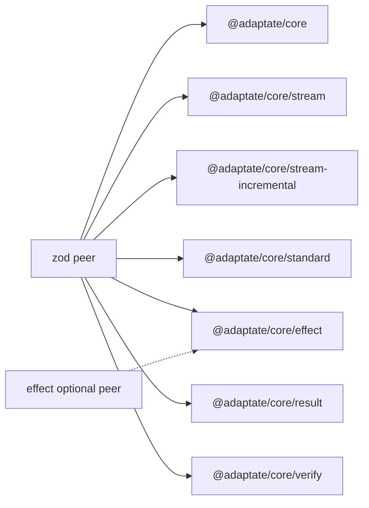

# Subpaths

`@adaptate/core` publishes seven entries and has no `dependencies`. `zod@^3.25.0 || ^4.0.0` is the required peer. `effect@^4.0.0` is an optional peer and is imported only by `@adaptate/core/effect`.

| Entry | Exports |
| --- | --- |
| `@adaptate/core` | `transformSchema`, `makeConditionalSchemaTransformer`, `transformPartialSchema`, `validatePartialAgainstConfigs`, `makeStreamingConditionalTransformer`, `Config`, `DeepPartial`, `PartialValidationResult` |
| `@adaptate/core/stream` | `parsePartialJson`, `createStreamValidator`, `validateStructuredOutput`, `createAgUiPartialValidator`, `agUiValidatorWith`, `reparseFeed`, `createFrameThrottle`, `AgUiDeltaEvent`, `PartialJsonFeed` |
| `@adaptate/core/stream-incremental` | `createPartialJsonFeed`, `fromAsyncIterable`, `fromAsyncIterableSteps`, `isSettled`, `createAgUiPartialValidator`, `PartialJsonFeed`, `JsonStreamStep`, `TrackedStep`, `JsonPath` |
| `@adaptate/core/standard` | `isStandardSchema`, `validateStandard`, `validateAgainstStandardSchemas`, `StandardSchemaV1`, `StandardIssue`, `StandardResult`, `StandardValidationResult` |
| `@adaptate/core/result` | `parse`, `parseAsync`, `parseStream`, `ok`, `err`, `isResult`, `isSettled`, `Result`, `Ok`, `Err`, `Track`, `Issues`, `StreamStep`, `JsonPath` |
| `@adaptate/core/effect` | `validate`, `validatePartial`, `createEffectStreamValidator`, `AdaptateValidationError`, `AdaptateParseError`, `ConfigReport`, `FinalReport` |
| `@adaptate/core/verify` | `hashBuffer`, `hexFromBytes`, `normalizeHex`, `verifiersFrom`, `verifyBuffer`, `verifyStream`, `Verifier`, `VerifyContext`, `VerifyFailure`, `VerifyManifest`, `HashAlgorithm`, `VerifyCheck`, `VerifyResult` |

`@adaptate/core/stream-incremental` also exports `createTrackedFeed` and `TrackedFeed`, which `makeFeed` returns.

Optional Advanced packages are not core subpaths and are not pulled in by `@adaptate/core`:

| Package | What it is for |
| --- | --- |
| `@adaptate/accel` | Probe and size-route large-buffer or batched in-memory work |
| `@adaptate/wasm` | Portable C ABI WASM. Browsers should import `@adaptate/wasm/runtime` so `node:fs` does not enter the bundle. |
| `@adaptate/native` | Node-API bindings, including an optional hardware GPU path above 4 MiB |

`@adaptate/utils` has no required runtime dependencies. Its peers are in [Optional peers](optional-peers.md). Published paths:

| Import | Runtime file |
| --- | --- |
| `@adaptate/utils` | `build/index.es.js` (browser bundle; Node builtins are external) |
| `@adaptate/utils/openapi` | `ssr-build/openapi.js` |
| `@adaptate/utils/ssr` | `ssr-build/index.js` |

Use `/ssr` or `/openapi` when loading a spec from disk.
