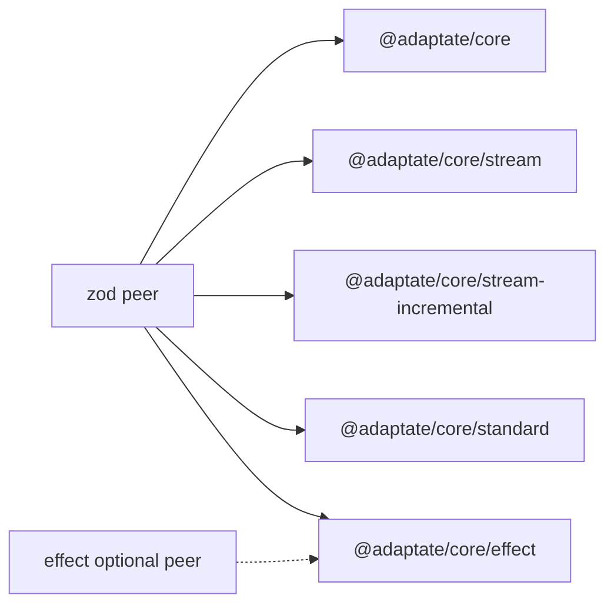

# Subpaths

`@adaptate/core` publishes five entries and has no `dependencies`. `zod@^3.25.0 || ^4.0.0` is the required peer. `effect@^4.0.0` is an optional peer and is imported only by `@adaptate/core/effect`.

| Entry | Exports |
| --- | --- |
| `@adaptate/core` | `transformSchema`, `makeConditionalSchemaTransformer`, `transformPartialSchema`, `validatePartialAgainstConfigs`, `makeStreamingConditionalTransformer` |
| `@adaptate/core/stream` | `parsePartialJson`, `createStreamValidator`, `validateStructuredOutput`, `createAgUiPartialValidator`, `createFrameThrottle` |
| `@adaptate/core/stream-incremental` | `createPartialJsonFeed`, `fromAsyncIterable`, `createAgUiPartialValidator` |
| `@adaptate/core/standard` | `isStandardSchema`, `validateStandard`, `validateAgainstStandardSchemas` |
| `@adaptate/core/effect` | `validate`, `validatePartial`, `createEffectStreamValidator`, `AdaptateValidationError`, `AdaptateParseError` |

`@adaptate/utils` has no required runtime dependencies. Its peers are in [Optional peers](optional-peers.md). Published paths:

| Import | Runtime file |
| --- | --- |
| `@adaptate/utils` | `build/index.es.js` (browser bundle; Node builtins are external) |
| `@adaptate/utils/openapi` | `ssr-build/openapi.js` |
| `@adaptate/utils/ssr` | `ssr-build/index.js` |

Use `/ssr` or `/openapi` when loading a spec from disk.
