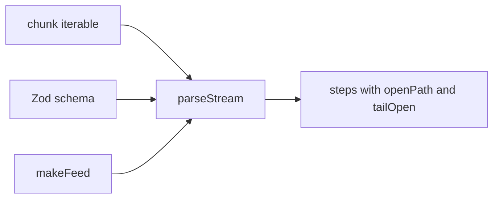

# v3 feeds

A wrapping `makeFeed` around `createTrackedFeed`, passed to `parseStream` with a Zod schema and three JSON chunks.



<!-- snippet: usages/make-feed.ts -->
```ts
import { parseStream } from "@adaptate/core/result";
import {
  createTrackedFeed,
  type TrackedFeed,
} from "@adaptate/core/stream-incremental";
import { z } from "zod";

export let recipe = z.object({
  title: z.string(),
  tags: z.array(z.string()),
});

export async function* chunks() {
  yield '{"title":"Pas';
  yield 'ta","tags":["c1","c';
  yield '2"]}';
}

export function makeFeed(): TrackedFeed {
  let inner = createTrackedFeed();
  return {
    push: (chunk) => inner.push(chunk),
    complete: () => inner.complete(),
    ended: () => inner.ended(),
    openPath: () => inner.openPath(),
    tailOpen: () => inner.tailOpen(),
  };
}

export async function collectRecipeSteps() {
  let steps = [];
  for await (let step of parseStream(
    chunks(),
    recipe,
    recipe.partial(),
    makeFeed,
  )) {
    steps.push({
      done: step.done,
      openPath: step.openPath,
      tailOpen: step.tailOpen,
      ok: step.result.ok,
      value: step.result.ok
        ? step.result.value
        : step.result.error,
    });
  }
  return steps;
}
```
<!-- /snippet -->

That stream yields:

| Step | done | openPath | tailOpen | result.value |
| --- | --- | --- | --- | --- |
| 1 | false | `["title"]` | true | `{ title: "Pas" }` |
| 2 | false | `["tags", 1]` | true | `{ title: "Pasta", tags: ["c1", "c"] }` |
| 3 | false | `[]` | false | `{ title: "Pasta", tags: ["c1", "c2"] }` |
| 4 | true | `[]` | false | `{ title: "Pasta", tags: ["c1", "c2"] }` |

Steps 1–3 are incremental. Step 4 is the final schema check.

| Need | Hook |
| --- | --- |
| Same stream, a different feed | Pass `makeFeed`. `openPath` and `tailOpen` stay on the step. |
| Verify bytes before they settle | Wrap the feed, or run `verifyBuffer` / `verifyStream`. See [Runtime verification](verification.md). |
| Large buffers | Optional `@adaptate/accel`. See [Acceleration](accel.md). |

`fromAsyncIterableSteps` takes the same `makeFeed` and yields `{ value, complete, openPath, tailOpen }`. [Streaming](streaming.md) covers the path already on npm. The [live benchmark](accel.md#live-benchmark) shows when WASM is worth adding.
