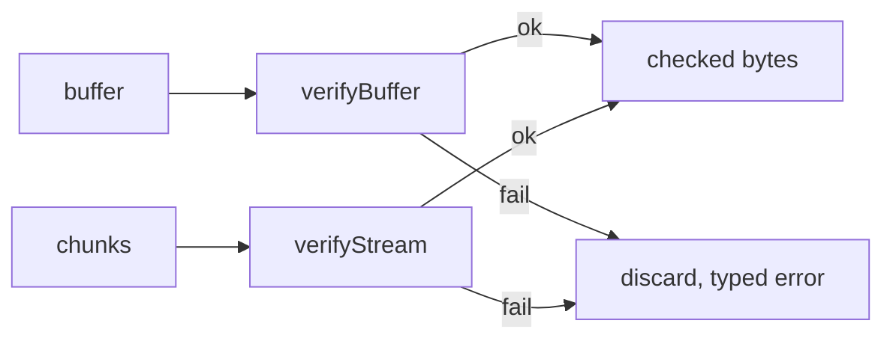

# Runtime verification

A download or a stream should not touch the disk until it has been checked. [Issue 84](https://github.com/p10ns11y/adaptate/issues/84) is covered by `@adaptate/core/verify`.



| Check | When it runs | On failure |
| --- | --- | --- |
| SHA-256 (or SHA-384 / SHA-512) | Over the in-memory bytes | Typed hash error, bytes discarded |
| Size, media type, name | Against an expected manifest | Typed metadata error, bytes discarded |
| Formal spec or custom verifier | After the built-in checks, still in memory | Typed verifier error, bytes discarded |

```ts
import { verifyBuffer, verifyStream } from "@adaptate/core/verify";

const checked = await verifyBuffer(bytes, {
  hash: { value: expectedSha256 },
  size: bytes.byteLength,
});

if (!checked.ok) {
  checked.failures;
}

const streamed = await verifyStream(chunks, {
  hash: { algorithm: "SHA-256", value: expectedSha256 },
});
```

`@adaptate/core/verify` is part of zero-dependency `@adaptate/core`. For a large or batched buffer, `@adaptate/accel` can size-route the same kind of check; see [Acceleration](accel.md). Pair this with [`makeFeed`](v3.md) when the bytes arrive as a stream.

This page is under Advanced because the hooks check untrusted buffers in memory, not ordinary fields on a small tool-call chunk. If a hook cannot decide, it does not write.
