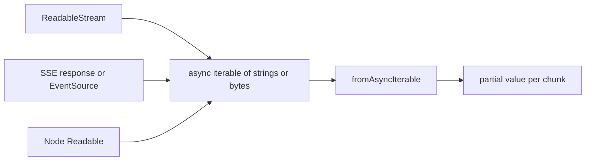

# Web streams

Every source below ends in the same place: an async sequence of strings or bytes that `fromAsyncIterable` turns into partial values.



```ts
import { fromAsyncIterable } from "@adaptate/core/stream-incremental";

async function* chunks() {
  yield '{"title":';
  yield '"Pas';
}

for await (const partialValue of fromAsyncIterable(chunks())) {
  console.log(partialValue);
}
```

## ReadableStream

<!-- snippet: usages/web-readable.ts -->
```ts
import { fromAsyncIterable } from "@adaptate/core/stream-incremental";

export async function* iterateReadable(
  stream: ReadableStream<Uint8Array>,
): AsyncGenerator<Uint8Array> {
  let reader = stream.getReader();
  try {
    for (;;) {
      let step = await reader.read();
      if (step.done) return;
      if (step.value) yield step.value;
    }
  } finally {
    reader.releaseLock();
  }
}

export async function collectWebStream(stream: ReadableStream<Uint8Array>): Promise<unknown[]> {
  let partials: unknown[] = [];
  for await (let partialValue of fromAsyncIterable(iterateReadable(stream))) {
    partials.push(partialValue);
  }
  return partials;
}
```
<!-- /snippet -->

## Server-sent events

<!-- snippet: usages/sse.ts -->
```ts
export function frameSseData(delta: string): string {
  return `data: ${delta}\n\n`;
}

export async function readSse(response: Response, onDelta: (delta: string) => void): Promise<void> {
  let body = response.body;
  if (!body) return;
  let reader = body.getReader();
  let decoder = new TextDecoder();
  let buffer = "";
  try {
    for (;;) {
      let step = await reader.read();
      if (step.done) {
        buffer += decoder.decode();
        break;
      }
      buffer += decoder.decode(step.value, { stream: true });
      buffer = emitSseBlocks(buffer, onDelta);
    }
    emitSseBlocks(`${buffer}\n\n`, onDelta);
  } finally {
    reader.releaseLock();
  }
}

export function attachEventSource(source: EventSource, onDelta: (delta: string) => void): () => void {
  let onMessage = (event: MessageEvent) => {
    if (typeof event.data !== "string") return;
    if (event.data.length === 0 || event.data === "[DONE]") return;
    onDelta(event.data);
  };
  source.addEventListener("message", onMessage);
  return () => {
    source.removeEventListener("message", onMessage);
  };
}

export async function readSseFromFetch(
  input: RequestInfo | URL,
  onDelta: (delta: string) => void,
): Promise<void> {
  let response = await fetch(input);
  await readSse(response, onDelta);
}

function emitSseBlocks(buffer: string, onDelta: (delta: string) => void): string {
  let separator = buffer.indexOf("\n\n");
  while (separator >= 0) {
    let block = buffer.slice(0, separator);
    buffer = buffer.slice(separator + 2);
    emitSseBlock(block, onDelta);
    separator = buffer.indexOf("\n\n");
  }
  return buffer;
}

function emitSseBlock(block: string, onDelta: (delta: string) => void): void {
  let dataLines: string[] = [];
  for (let line of block.split("\n")) {
    if (!line.startsWith("data:")) continue;
    let value = line.slice("data:".length);
    dataLines.push(value.startsWith(" ") ? value.slice(1) : value);
  }
  if (dataLines.length === 0) return;
  let data = dataLines.join("\n");
  if (data.length === 0 || data === "[DONE]") return;
  onDelta(data);
}
```
<!-- /snippet -->

## Node streams and provider deltas

<!-- snippet: usages/node-stream.ts -->
```ts
import { Readable } from "node:stream";
import { pipeline } from "node:stream/promises";
import { fromAsyncIterable } from "@adaptate/core/stream-incremental";

export type OpenAiToolChunk = {
  choices?: Array<{
    delta?: {
      tool_calls?: Array<{
        function?: {
          arguments?: string;
        };
      }>;
    };
  }>;
};

export type AnthropicInputChunk = {
  delta?: {
    type?: string;
    partial_json?: string;
  };
};

export async function* openAiArguments(
  events: AsyncIterable<OpenAiToolChunk>,
): AsyncGenerator<string> {
  for await (let event of events) {
    let delta = event.choices?.[0]?.delta?.tool_calls?.[0]?.function?.arguments;
    if (typeof delta === "string" && delta.length > 0) yield delta;
  }
}

export async function* anthropicInputJson(
  events: AsyncIterable<AnthropicInputChunk>,
): AsyncGenerator<string> {
  for await (let event of events) {
    let delta = event.delta;
    if (
      delta?.type === "input_json_delta" &&
      typeof delta.partial_json === "string" &&
      delta.partial_json.length > 0
    ) {
      yield delta.partial_json;
    }
  }
}

export async function collectNodeStream(readable: Readable): Promise<unknown[]> {
  let partials: unknown[] = [];
  await pipeline(readable, async function collect(source) {
    for await (let partialValue of fromAsyncIterable(source as AsyncIterable<string | Uint8Array>)) {
      partials.push(partialValue);
    }
  });
  return partials;
}
```
<!-- /snippet -->

Each file is typechecked and run by the site tests.
