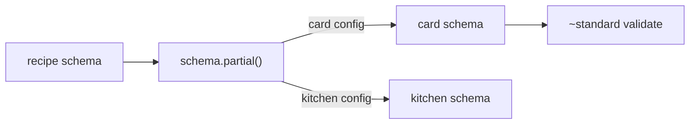

# Zod

One schema describes the data. Each view states which fields it needs. A title alone passes the card and fails the kitchen.



```ts
import { z } from "zod";
import { transformSchema } from "@adaptate/core";

const recipe = z.object({ title: z.string(), servings: z.number() });
transformSchema(recipe.partial(), { title: true }).parse({ title: "Pas" });
```

The file below is typechecked and run by the site tests.

<!-- snippet: usages/zod.ts -->
```ts
import { transformSchema, type Config } from "@adaptate/core";
import { validateStandard } from "@adaptate/core/standard";
import { z } from "zod";

export let recipeSchema = z.object({
  title: z.string(),
  servings: z.number(),
});

export type Recipe = z.infer<typeof recipeSchema>;

export let cardConfig = { title: true } satisfies Config<Recipe>;
export let kitchenConfig = { title: true, servings: true } satisfies Config<Recipe>;

export let cardSchema = transformSchema(recipeSchema.partial(), cardConfig);
export let kitchenSchema = transformSchema(recipeSchema.partial(), kitchenConfig);

export function readyViews(recipe: Partial<Recipe>) {
  return {
    card: cardSchema.safeParse(recipe).success,
    kitchen: kitchenSchema.safeParse(recipe).success,
  };
}

export async function checkWithStandardSchema(recipe: unknown) {
  return validateStandard(cardSchema, recipe);
}
```
<!-- /snippet -->

`validateStandard` comes from `@adaptate/core/standard`. It accepts any schema with `~standard.validate`, so a valibot or ArkType schema works the same way. See [Transform](transform.md) for config values and [TypeScript](typescript.md) for the published types.
