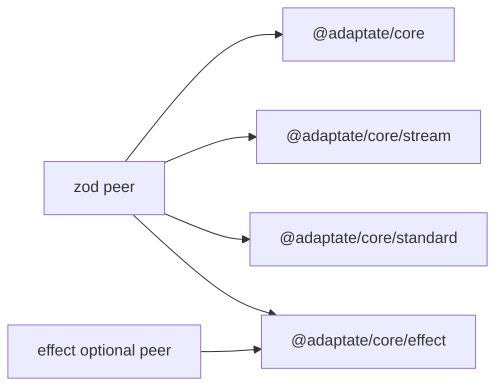

# @adaptate/core

Schema transformation engine — make Zod schema fields required based on configuration objects.

## Installation

```sh
pnpm add @adaptate/core
# or
npm install @adaptate/core
```

Peer dependency: `zod@^3.25.0 || ^4.0.0`

## Entries



No `dependencies`. `effect@^4.0.0` is an optional peer and is imported only from `@adaptate/core/effect`.

```ts
import { Effect } from "effect";
import { z } from "zod";
import { createEffectStreamValidator } from "@adaptate/core/effect";

const recipe = z.object({
  title: z.string().optional(),
  servings: z.number().optional(),
});
const validator = createEffectStreamValidator(recipe, {
  card: { title: true },
  kitchen: { servings: true },
});

const report = Effect.runSync(validator.final('{"title":"Pasta"}'));
// report.configs.card.valid === true
// report.configs.kitchen.valid === false

const card = Effect.runSync(validator.final('{"title":"Pasta"}', "card"));
// { title: "Pasta" }
```

`final(text)` returns `{ value, configs }` after the base schema passes. `final(text, "card")` returns the value for that config. An unknown `configName` fails with `AdaptateValidationError` and issue `unknown config`.

**Monorepo development:** If you clone the **adaptate** repo to work on source, use **pnpm** at the repo root only — required for the repo’s supply-chain protections ([Development](../../README.md#development) in the root README). The install commands above remain correct when installing **published** packages from npm.

## API

### `transformSchema(schema, config)`

Transforms a Zod schema by making specified fields required based on a config object.

**Config values:**
- `true` — make the field required (strip optionality)
- `false` — keep the field optional
- Nested object — recurse into sub-schema
- `{ '*': config }` — apply config to all array elements

```ts
import { z } from 'zod';
import { transformSchema, type Config } from '@adaptate/core';

const schema = z.object({
  name: z.string().optional(),
  age: z.number().optional(),
  address: z.object({
    street: z.string().optional(),
    city: z.string().optional(),
  }).optional(),
});

const config = {
  name: true,
  age: true,
  address: { city: true },
} satisfies Config<z.infer<typeof schema>>;

const updatedSchema = transformSchema(schema, config);

updatedSchema.parse({ name: 'Davin', age: 30, address: { city: 'Pettit' } }); // passes
updatedSchema.parse({ name: 'Davin', age: 30, address: { street: 'Main St' } } ); // throws
```

### `Config<T>` (Type Helper)

Fully typed config for autocomplete and compile-time safety.

```ts
const config = {
  name: true,
  address: { city: true },
  tags: { '*': true },
} satisfies Config<z.infer<typeof userSchema>>;
```

### `makeConditionalSchemaTransformer(data)`

Creates a transformer that can apply conditional requirements based on runtime data.

**Config values (in addition to above):**
- `(data) => boolean` — function that determines if field is required
- `{ requiredIf: (data) => boolean }` — explicit conditional syntax

```ts
import { z } from 'zod';
import { makeConditionalSchemaTransformer } from '@adaptate/core';

const schema = z.object({
  parentContactNumber: z.number().optional(),
  age: z.number().optional(),
});

const config = {
  parentContactNumber: { requiredIf: (data: any) => data.age < 18 },
  age: true,
};

const data = { age: 17 };
const transformer = makeConditionalSchemaTransformer(data)(schema, config);

transformer.run(); // throws — parentContactNumber required because age < 18
```

**Transformer properties:**
- `transformer.schema` — the transformed Zod schema
- `transformer.run()` — shorthand for `transformer.schema.parse(data)`
- `transformer.staticConfig` — config with conditionals removed (for use with `transformSchema`)

## How It Works

The engine recursively traverses the Zod schema tree:
1. Checks if a field is optional → uses `.unwrap()` to strip optionality
2. For nested objects → recurses with the nested config
3. For arrays with `'*'` config → applies config to element schema
4. Merges the transformed shape back with the original using `ZodObject.merge()`

This preserves all fields not mentioned in the config while making specified fields required.
